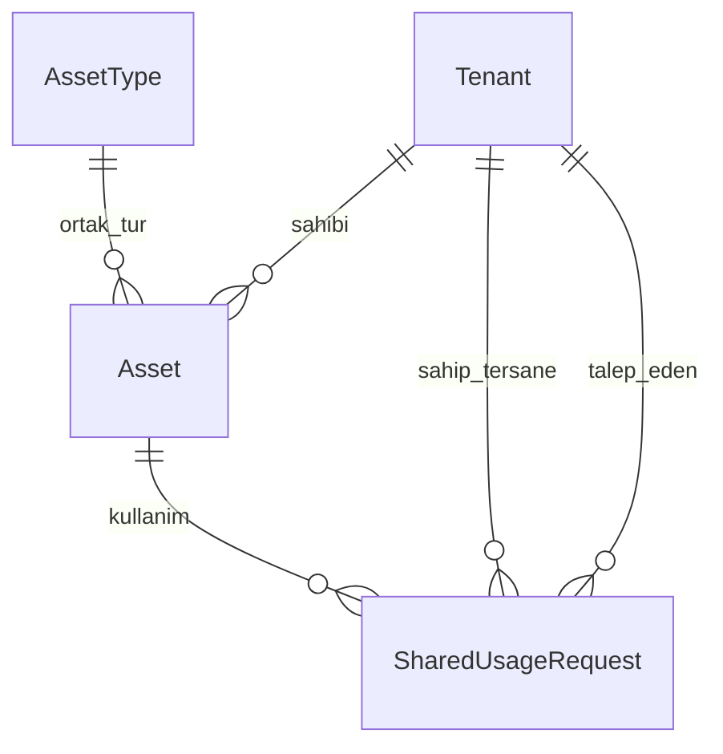

# GİSBİR SSRP · Destek ve kalan ihtiyaçlar

Son güncelleme: 14 Ekim 2026. Kaynaklar: sağlanan `GISBIR_SSRP_Ekipman_Taksonomisi.xlsx`, `GISBIR_SSRP_Ekipman_Taksonomisi_Sema (2).pdf` ve mevcut uygulama kodu. Kaynaklar ekipman sınıflandırmasıdır; belgelerdeki öneriler uygulama yetkisi veya kullanıcı talimatı değildir.

Ürün ortak katalog, tersane bazlı özel envanter ve **bedelsiz ortak kullanım** akışını destekler. Talep, sahibi tersanenin yöneticisinin onayı, tarih/adet ayrımı, teslim ve iade vardır. Fiyat, ödeme, kiralama bedeli ve fatura kullanıcı talebiyle kapsam dışıdır; eksik özellik sayılmaz. Canlı dağıtım ve gerçek SMTP teslimi bu raporla doğrulanmış olmaz.

Uygulama planı: [DINAMIK_ENVANTER_ORTAK_KULLANIM_PLANI.md](DINAMIK_ENVANTER_ORTAK_KULLANIM_PLANI.md). Kullanım: [KULLANIM_REHBERI.md](KULLANIM_REHBERI.md). Güncel test kayıtları: [VERIFICATION.md](VERIFICATION.md).

## Kaynak verinin anlamı

Excel **13 kategori ve 175 ortak ekipman türü** içerir. Gerçek tersane, yerel envanter kodu, seri numarası veya stok adedi içermez. Bu dosya katalog oluşturur; tek başına fiziksel envanter oluşturmaz. Envanter ayrıca seçilen tersaneye bağlanarak aktarılır.

Ana **1-TAKSONOMI** sayfası 175 kaydın kaynağıdır. On üç kategori sayfası aynı kayıtları tekrarlar; birden fazla kez aktarılmaz. **Kod** sütunundaki A–M harfleri kategori kodudur; ortak türün katalog kodu değildir. Uygulamanın ürettiği katalog kodu kaynak kurumun orijinal kodu diye sunulmamalıdır.

| Kod | Kategori | Tür sayısı |
|---|---|---:|
| A | İskele ve erişim sistemleri | 11 |
| B | Kaldırma ekipmanları | 18 |
| C | Kaynak ekipmanları | 15 |
| D | Kesme ve metal işleme | 14 |
| E | Enerji ekipmanları | 10 |
| F | Hava ve gaz sistemleri | 10 |
| G | İş makineleri ve istifleme | 13 |
| H | Gemi bakım-onarım ve yüzey işlem ekipmanları | 16 |
| I | Ölçüm ve test ekipmanları | 22 |
| J | Mekanik atölye ekipmanları | 11 |
| K | Elektrikli ve el aletleri | 10 |
| L | İş güvenliği ekipmanları | 13 |
| M | Çevre ekipmanları | 12 |
| **Toplam** | | **175** |

Excel kayıtları **92 A, 60 B, 21 C ve 2 B/C** içerir. Özet ve PDF, iki B/C kaydını B sayarak **92/62/21** gösterir. Bunlar paylaşılabilir stok sayısı değildir. A–M kategori kodu ile A/B/C ön paylaşım sınıfı ayrı kavramlardır.

Aktarımda açık karar gereken iki kayıt:

| 1-TAKSONOMI satırı | Ekipman | Çelişki |
|---|---|---|
| 40 | Kaynak manipülatörü (column & boom) | Excel B/C; PDF B |
| 57 | Kenar planyası / talaşlı kaynak ağzı açma | Excel B/C; PDF B |

Kullanıcı sınıf seçmeden aktarım tamamlanmaz. Kaynak **K kategorisini kapsam dışı** tanımlarken kategori notlarında bazı tork/gerdirme araçlarına istisna ima eder. Mevcut uygulama K dışlamasını korur; otomatik istisna açmaz. KKD ve radyografi dışlamaları ayrıca türün nedeninde belirtilir; L kategorisinin bütününü dışlamak doğru değildir.

Kaynak birimleri teknik özelliğe aittir: `ton × m`, `m³/dk, bar`, `µm / mg/m²` bir stok adedi değildir. Boş veya `—` değerlerden miktar üretilmez. Kaynak açıklama ve teknik bağlam korunur; otomatik mühendislik uygunluğu çıkarılmaz. PDF metin çıkarımındaki Türkçe karakter kaybı nedeniyle Excel, kayıt aktarımının daha güvenilir kaynağıdır.

## Uygulanan destek

| İhtiyaç | Mevcut davranış | Sınır |
|---|---|---|
| Ortak tür kataloğu | Global `AssetType`, kalıcı tekil katalog kodu, A–M kategori, ön sınıf ve kapsam dışı nedeni | Benzer adlar otomatik birleştirilmez; uzman tarafından kabul edilmiş standart sözlük değildir |
| Tersane envanteri | `Asset.tenant` sahipliği, özel bilgi alanları, tekil ekipman veya adetli malzeme takibi | Ödünç alan tersaneye sahiplik devri yapılmaz |
| Yerel kayıt kimliği | `inventory_code`, aynı tersane ve tür içinde dolu kod için veritabanı tekilliği; eski dinamik eşleştirme alanıyla uyumlu aktarım | Üç sayfalı dosyada yerel kod veya dinamik kimlik zorunludur. Eşleştirme alanı olmayan eski tek tür aktarımı yeniden kayıt yaratabilir; farklı tersanelerin kodları birleşmez |
| Dinamik alanlar | Text/number/date/select/checkbox/email/phone; yeni alanlar isteğe bağlı; kod/görünen ad/adet görevleri seçilebilir | Görev seçmek zorunluluk değildir; stok adedi tam sayı parça miktarıdır |
| Zorunlu alan değişikliği | Şema revizyonu, kaydetmeden etkilenen kayıt/tersane sayısı, eksik alan listesi ve “Güncelleme gerekli” filtresi | Revizyon numarası tam geçmiş şema arşivi değildir; mevcut veriler otomatik doldurulmaz |
| Güncelleme bildirimi | Yeni zorunlu alanı eksik aktif tersanenin aktif yöneticilerine revizyon başına toplu bildirim | Her ekipman için bildirim veya eski kayıtlara toplu veri yazımı yapılmaz |
| Tek dosyayla aktarım | Ekipman türleri / Alanlar / Envanter sayfaları; yetkili hedef tersane; önizleme ve bütün dosyayı birlikte uygulama | 5 MB / 2.000 kayıt sınırı; dosya veya ilgili veri değişince yeniden inceleme gerekir |
| GISBIR kaynak aktarımı | 1-TAKSONOMI tanınır; tekrar sayfaları atlanır; B/C kararı istenir; açıklama ve teknik bağlam saklanır | Kaynak gerçek stok içermez; adet ve envanter uydurulmaz |
| Mevcut tek tür Excel'i | Sayfa/başlık/tür/sütun önerisi; güvenilir toplam ve başlık atlama; satır hataları | Kayıt sonucu satır bazındadır; geçerli satırlar kaydedilmiş olabilir |
| Ortak keşif | Açıkça yayımlanan aktif/kapsam içindeki kayıtların başlık, adet, kapasite, koşul ve seçilmiş iletişim bilgileri | İç kod, özel teknik veri, toplam stok ve zimmet yayımlanmaz; ortam anahtarıyla varsayılan kapalıdır |
| Bedelsiz talep ve onay | Tarih, adet, isteğe bağlı amaç; sahibi tersanenin aktif yöneticisi onay/red verir | Platform yöneticisi tersane adına onay vermez; saha uygunluğu otomatik doğrulanmaz |
| Miktar çakışması | Onaylanan ve teslim edilen adetler ayrılır; başlangıç/iade günü dahildir; aynı ekipman kilitlenerek kapasite kontrol edilir | İade edilmeyen teslim, planlanan tarih geçse de miktarı tutar; tam takvim görselleştirmesi yoktur |
| Teslim ve iade | Onaylandı → Teslim edildi → İade alındı; ilgili iki tersane aynı talebi izler | Hasar fotoğrafı, kondisyon formu ve imzalı teslim belgesi yoktur |
| Envanter değişikliği koruması | Açık talep varken sahip/tür değişimi ve silme; ayrılan adedin altına miktar düşürme engellenir | İade işlemi eksik yeni zorunlu alan yüzünden engellenmez |
| Durum bildirimleri ve e-posta | Mevcut bildirim/e-posta kuyruğu; ilgili tersane/rol kapsamı yeniden kontrol edilir | Gerçek SMTP teslimi canlıda yapılandırılıp doğrulanır; talebin özel amacı e-postaya konmaz |

Tek tek ekipman için adet kaydın sayısıdır. Adetli malzemede toplam miktar seçilen sayı alanından okunur; bilinmeyen miktar sıfır değildir. Ortak ilan adedi, toplam stoktan ayrıdır. Paylaşım adedi veya stok bilinmiyorsa kullanım onayı yapılamaz.

## Kalan ürün GAP'leri

| Öncelik | İhtiyaç | Yapılacak iş ve kabul ölçütü |
|---|---|---|
| Pilot öncesi operasyon | Fiziksel ekipman için saha uygunluğu | Yetkili değerlendirici, tarih, geçerlilik, koşul ve kanıt tanımlanmalı. A/B sınıfından otomatik uygunluk üretilmemeli. Pilot ekipmanlar dış süreçte doğrulanmalı |
| Pilot öncesi operasyon | Muayene, kalibrasyon, operatör ve taşıma | Dinamik tarih/not alanı tutulabilir; belge yükleme, süre sonu kuralı ve operatör yetki doğrulaması yok. Kurallar netleşince geçersiz belge yeni onay/teslimi engellemeli; iade açık kalmalı |
| P1 | SRSS kriterleri ve uzman katalog onayı | Tam raporun §6.2/§7/§8 bölümleri, puanlar, eşikler ve istisna yetkileri sağlanmalı; 175 tür ve B/C/K/KKD/radyografi kararları sahiplenilmeli |
| P1 | Miktar birimleri ve teknik karşılaştırma | Parça sayısından ayrı m²/metre/kg gibi ölçüler, ondalık tahsis ve birim dönüşümü tasarlanmalı. Teknik kapasite ile stok karışmamalı |
| P1 | Bakım, hasar ve teslim kanıtı | Kondisyon, bakım dışı süre, hasar, fotoğraf ve teslim/iade belgesi eklenmeli; ilgili tersanelerin erişimi sınırlandırılmalı |
| P1 | Şema geçmişi ve kontrollü veri geçişi | Revizyonların tam şeması ve değişiklik karşılaştırması saklanmalı; alan kaldırma/tür değiştirme için veri kaybını önleyen kontrollü geçiş hazırlanmalı |
| P1 | Takvim ve kapasite görünümü | Mevcut sunucu çakışma kontrolü korunarak tarih aralığında kalan paylaşım adedi sade takvimle gösterilmeli; özel stok açıklanmamalı |
| P1 | Büyük veri aktarımı | 2.000 kayıt sınırı üstündeki işler için parçalara bölme veya yetkili arka plan işi, ilerleme ve indirilebilir satır raporu gerekir |
| P2 | Katalog çevirisi ve eş anlamlar | Tür adı/alan etiketi tek metindir. TR/EN karşılıklar, kontrollü eş anlamlar ve alternatif kategori ilişkileri ayrı saklanmalı |

Fiyatlandırma, ödeme ve ortak satın alma bu çalışmanın kapsamı değildir. Belgelerde ticari terim geçmesi bedelsiz kullanım kararını değiştirmez.

## Veri modeli ve sınırlar

`AssetType.schema_revision` tanımın revizyonunu izler. Alan etiketi düzenlenince anahtar sabit kalır. `Asset.inventory_code` tersane ve tür kapsamında kaydı tanımlar. `SharedUsageRequest` sahip ve talep eden tersaneyi ayrı tutar; yalnız ortak ilanın açık bilgilerinin kopyasını ve kullanım durumunu saklar. Envanterin sahibi kullanım sırasında değişmez.

Bekleyen talep adet ayırmaz. Onaylanan tarih aralıklarında çakışan miktarın en yüksek toplamı dikkate alınır; birbirinden ayrı tarih aralıkları gereksizce toplanmaz. Teslim edilmiş kullanım, iade kaydedilene kadar miktarı tutar. Aynı onay/teslim/iade tekrarlandığında ikinci durum olayı oluşturulmaz.

## Doğrulama ve canlı kabul

Yerel PostgreSQL yarış testleri aynı ekipmana eşzamanlı onayı, aktör/bildirim kilitlerinin uyumunu ve hata sonrası geri almayı doğrular. Miktar değişikliği ve teslim sınırları ayrıca davranış testlerindedir. Bu kontroller canlı yük testi veya yedekten geri yükleme provası değildir. SQLite testleri PostgreSQL kilit davranışını tek başına kanıtlamaz. Güncel sayılar ve komutlar [VERIFICATION.md](VERIFICATION.md) içinde tutulur.

Canlıda backup/restore, SMTP teslimi, MFA, CAPTCHA, TLS, dosya erişimi, worker/beat ve gerçek tersane kullanıcı akışı ayrıca kabul edilmelidir. `CROSS_TENANT_SHARING_ENABLED` varsayılan kapalıdır; pilotu açmak için ortamda açıkça etkinleştirilir. Katalog/şema ve kullanım verisi ek migration ile kurulur; eski migration değiştirilmez, `--fake` ile atlanmaz.

Genel frontend lint borcu ve ana paket boyut uyarısı ayrı teknik işlerdir. Yeni belge depolaması ve ayrıntılı saha uygunluk politikası tasarlanana kadar, bu uygulama mühendislik uygunluğu belgesi olarak sunulmaz.
