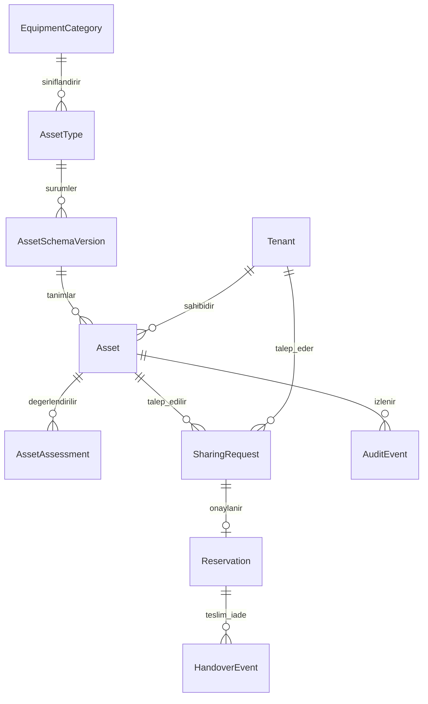

# GİSBİR SSRP: mevcut destek, düzeltmeler ve GAP analizi

Tarih: 21 Eylül 2026. Kaynak: `GISBIR_SSRP_Ekipman_Taksonomisi_Sema.pdf`, tek sayfalık A2 şema; mevcut backend/frontend kaynak kodu ve `PRODUCT_REQUIREMENTS.md`.

## Sonuç

Uygulama **kurumun sahip olduğu ekipmanların envanterini ve ortak ekipman türü tanımlarını** tutabilir. PDF'deki ekipman adları tür olarak, fiziksel ekipmanlar da bu türlerin ekipmanları olarak kaydedilebilir. Ancak **ortak tür kullanmak, fiziksel ekipmanın kullanımını kurumlar arasında tahsis etmek değildir**. 14 Ekim güncellemesiyle yalnız tersanenin açıkça yayımladığı ekipmanlar için kontrollü ortak liste eklendi. Kullanım talebi, operasyonel onay, rezervasyon, teslim/iade ve miktar tahsisi akışı hâlâ yoktur. Ürün merkezi envanter ve listeleme olarak sunulabilir; tam SSRP kullanım/kiralama süreci değildir.

Güncel listeleme MVP'sinin öncelikleri [ORTAK_ENVANTER_URUN_ANALIZI.md](ORTAK_ENVANTER_URUN_ANALIZI.md) içindedir. Bu rapordaki P0 değerlendirmeleri tam ortak kullanım operasyonu içindir; rezervasyon ve ödeme listeleme MVP'sinin zorunlu başlangıç kapsamı sayılmaz.

Bu çalışma mevcut davranış hatalarını giderir ve SSRP geliştirmesinin kapsamını çıkarır. PDF'deki 175 tip veritabanına otomatik yüklenmedi; yeni rezervasyon veya ticari model uygulanmadı. Canlı sunucuya dağıtım yapılmadı.

## PDF'nin söylediği ve söylemediği

- A–M arasında **13 ana kategori ve 175 ekipman tipi** var.
- Ön paylaşım sınıfı toplamları: **92 A, 62 B, 21 C**. A ortak kullanıma çok uygun, B şartlı uygun, C uygun değil.
- Kategori kodu `A` ile paylaşım sınıfı `A` farklı kavramlardır; iki ayrı alan olmalıdır.
- **K kategorisi kapsam dışıdır**. K içindeki A/B rozetleri bu dışlamayı kaldırmaz.
- L kategorisindeki kişisel koruyucu donanım ve I kategorisindeki radyografi ekipmanı paylaşıma açılmaz. L'nin tamamı otomatik olarak dışlanmamalıdır; hangi kayıtların KKD olduğu açıkça işaretlenmelidir.
- Ön sınıf jenerik mühendislik değerlendirmesidir. **Nihai karar her fiziksel ekipman için saha doğrulamasıyla** belirlenir. A sınıfı etiketi otomatik rezervasyon izni değildir.
- PDF raporun §6.2, §7 ve §8/SRSS bölümlerine atıf yapıyor. Tam rapor verilmediği için SRSS puanları, eşikler, değerlendirme formu ve onay makamları bu şemadan çıkarılamaz.
- Başlıktaki satın alma/kiralama kapsamının fiyatlandırma, vergi, sözleşme ve ödeme kuralları bu sayfada tanımlanmıyor.

### Kategori envanteri

| Kod | Kategori | Tip sayısı |
|---|---|---:|
| A | İskele ve erişim sistemleri | 11 |
| B | Kaldırma ekipmanları | 18 |
| C | Kaynak ekipmanları | 15 |
| D | Kesme ve metal işleme | 14 |
| E | Enerji ekipmanları | 10 |
| F | Hava ve gaz sistemleri | 10 |
| G | İş makineleri ve istifleme | 13 |
| H | Gemi bakım-onarım ve yüzey işlem ekipmanları | 16 |
| I | Ölçüm ve test ekipmanları | 22 |
| J | Mekanik atölye ekipmanları | 11 |
| K | Elektrikli ve el aletleri — kapsam dışı | 10 |
| L | İş güvenliği ekipmanları — KKD istisnası var | 13 |
| M | Çevre ekipmanları | 12 |
| **Toplam** | | **175** |

92/62/21 dağılımı şemadaki genel toplamdır; dışlamalar ve saha değerlendirmesi uygulanmış paylaşılabilir stok sayısı değildir.

## Mevcut destek matrisi

| İhtiyaç | Destek | Kodda durum / gereken değişiklik | Öncelik |
|---|---|---|---|
| Tersane sahipliği | Var | `Tenant` ve `Asset.tenant`; kurum bazlı varlık sorguları. Bu çalışmada atanmamış/pasif kurum erişimleri ve yetki sınırları düzeltildi. | Temel |
| Ortak ekipman tipi tanımı | Var | Global `AssetType`; tüm tersaneler aynı tipi kullanabilir. PDF isimleri kayıt olarak girilebilir. | Temel |
| Tekil fiziksel ekipman | Kısmi | `Asset` UUID ve `custom_data` var; kurumsal ekipman kodu ve veritabanı düzeyinde tekillik yok. | P1 |
| 13 kategori / hiyerarşi | Kısmi | `AssetType` kategori kodunu doğrulanmış A–M seçenekleriyle tutuyor; kategori sözlüğü arayüzde var. Ayrı kategori modeli, kaynak ve sürüm kaydı yok. | P1 |
| 175 tiplik standart katalog | Kısmi | Önizlemeli ve atomik Excel katalog aktarımı, kalıcı katalog kodu ve tekrar aktarım koruması var. PDF'deki 175 adın uzman onaylı kaynak tablosu ve katalog sürümleme yok. | P1 |
| Tip düzeyinde ön A/B/C sınıfı | Var | Ön sınıf ve kapsam dışı nedeni ayrı metaveri; kategori koduyla karıştırılmıyor. Arayüz bunun paylaşım izni olmadığını açıkça belirtiyor. | Temel |
| Varlık düzeyinde nihai uygunluk | Yok | Saha değerlendirmesi, değerlendiren kişi, tarih, kanıt, geçerlilik ve gerekçe kaydı gerekir. | P0 |
| K / KKD / radyografi dışlamaları | Kısmi | K kategorisi, C sınıfı ve açık dışlama nedeni tip düzeyinde türetiliyor; KKD/radyografi Excel'de nedenle işaretlenebiliyor. Talep/rezervasyon API'si henüz olmadığı için operasyonel blokaj yok. | P0 |
| Teknik özellikler | Kısmi | Text/number/date/select/checkbox/email/phone alanları var. Bu çalışmada ortak doğrulama güçlendirildi. Birim, min/max, birleşik kapasite, teknik sözlük yok. | P1 |
| Stok miktarı ve birimi | Yok | Tekil ekipman ile m² iskele, metre bariyer veya kilogram malzeme ayrı takip edilmelidir. `quantity`, stok birimi ve tahsis hesabı yok. | P0 |
| Kapasite birimleri | Kısmi | Alan adlarıyla modellenebilir; ölçü boyutları ve dönüşüm kuralları yok. `ton × m` tek stok miktarı değildir. | P1 |
| Kurumlar arası keşif | Kısmi | Normal özel envanter kurumla sınırlıdır. Ayrı ortak listede yöneticinin açıkça yayımladığı aktif/kapsam içindeki ekipmanların sınırlı alanları görünür; yapılandırılmış kapasite/birim araması ve iletişim/talep kanalı eksik. | P1 |
| Talep ve onay | Yok | `SharingRequest`, onay yetkisi, gerekçeli red, iptal ve durum geçişleri yok. | P0 |
| Takvim / çakışmasız rezervasyon | Yok | `Reservation` modeli, zaman aralığı ve eşzamanlı tahsis kontrolü yok. | P0 |
| Teslim, iade, hasar, bakım | Yok | `assigned_to` kişi atamasıdır; kurumlar arası teslim/iade değildir. İşlem ve durum geçmişi gerekir. | P1 |
| Kalibrasyon / muayene / operatör | Yok | Tarih alanı tanımlanabilir; belge geçerliliği ve paylaşımı bloke eden kurallar yok. | P0 |
| Şema sürümleme ve değişiklik geçmişi | Yok | Tip şeması yerinde değişir; eski kayıtların hangi şemayla doğrulandığı saklanmaz. `created_by`/tarihler tam audit değildir. | P1 |
| Excel içe/dışa aktarım | Kısmi | Fiziksel ekipman aktarımına ek olarak katalog şablonu, satır önizlemesi, hata raporu, 5 MB/2.000 satır sınırı ve imzalı onay adımı var. Katalog kodu tekil; kapasite birim dönüşümü ve fiziksel ekipmanın veritabanı tekilliği eksik. | P1 |
| Türkçe/İngilizce | Kısmi | Arayüz i18n var; tip adı ve alan etiketleri tek metin. Katalog çevirileri ayrı saklanmalı. | P2 |
| Kiralama / ortak satın alma | Yok | Fiyat teklifi, sözleşme, maliyet dağıtımı, fatura/ödeme veya satın alma talebi modeli yok. Bu PDF bunların kurallarını da belirtmiyor. | P2 / ayrı kapsam |

P0: ortak kullanımı açmadan önce zorunlu ürün bileşeni. P1: kontrollü pilotun temel ihtiyacı. P2: sonraki kapsam. Bunlar geliştirme önceliğidir; PDF'nin mühendislik sınıfları değildir.

## Doğru modelleme örnekleri

| Örnek | Varlık tipi | Fiziksel varlık / stok | Paylaşım yorumu |
|---|---|---|---|
| Dizel forklift | G kategorisi; ön sınıf A; kapasite alanı ton | Tersane X'in FL-001 seri numaralı ekipmanı | A etiketi yalnız adaylık; saha onayı, bakım ve müsaitlik kontrolünden sonra talep edilebilir. |
| Ringlock iskele | A kategorisi; ön sınıf A | Tersane X'te 1.200 m² havuz; parça/set ilişkileri gerekebilir | 400 m² tahsiste toplam varlık sayısı değil miktar ve tarih bazlı müsaitlik azalır. |
| Mobil vinç | B kategorisi; ön sınıf B | Seri numaralı vinç, kapasite ton + erişim metre | B koşulları ve operatör/taşıma gereksinimleri doğrulanmadan onaylanmaz. Şema bunların ayrıntısını vermez. |
| Radyografi cihazı | I kategorisi; ön sınıf C; paylaşım dışı | Envanterde bulunabilir | Ortak katalogda talep edilebilir olarak yayınlanmamalı. |
| Avuç taşlama | K kategorisi; rozet A; kapsam dışı | Envanterde tutulabilir | K kapsam dışı kuralı A rozeti üzerinden aşılamaz. |
| Düşme durdurma harness/lanyard | L kategorisi; rozet B; KKD | Bireysel güvenlik ekipmanı | KKD dışlaması uygulanır; L'deki bariyer gibi diğer ekipmanlarla aynı karar verilmez. |

### Önerilen veri yapısı

Bu modelin katalog katmanı uygulanmıştır; fiziksel uygunluk, stok ve paylaşım işlem katmanları öneri olarak kalır.

- **EquipmentCategory:** sabit kod, TR/EN isim, kapsam durumu, kaynak/sürüm.
- **AssetType:** sabit katalog kodu, kategori, ön paylaşım sınıfı, dışlama nedeni, teknik alan şeması. Katalog etiketi ile fiziksel varlığın nihai kararı ayrılır.
- **Asset:** sahibi kurum, stabil ekipman kodu, tekil/havuz/sarf takip biçimi, stok miktarı-birimi, konum, bakım durumu, şema sürümü.
- **AssetAssessment:** değerlendiren, tarih, geçerlilik, nihai sınıf, koşullar ve kanıtlar. SRSS ayrıntıları tam rapordan gelmelidir.
- **SharingRequest / Reservation:** talep eden/sahip kurum, miktar, başlangıç-bitiş, karar veren, durum ve iptal gerekçesi. Kabul sırasında veritabanı işlemi ve kilitleme gerekir; yalnız arayüzdeki müsaitlik yeterli olmaz.
- **HandoverEvent / AuditEvent:** teslim alan/eden, kondisyon, iade, hasar ve her önemli değişikliğin kim/ne zaman/eski-yeni değerleri.

Varlığın `tenant` alanını ödünç alan kuruma çevirmek doğru değildir: sahiplik sabit kalmalı, kullanım ilişkisi ayrı kayıtta tutulmalıdır.

## Katalog aktarımında belirsizlikler

1. Şemadaki satırların sabit ekipman kodları yok. `G-001` gibi kodlar üretilecekse bunlar PDF'nin orijinal kodları diye sunulmamalı; ürünün iç kodları olarak tanımlanmalı.
2. I ve L'deki gaz dedektörleri, H ve M'deki grit geri kazanımı, I ve K'deki tork anahtarları benzer/örtüşen adlar taşıyor. Otomatik ad birleştirmesi yapılmamalı; eş anlam/alternatif kategori ilişkisi uzmanla netleştirilmeli.
3. Bazı tiplerde birim boş, bazıları çok boyutlu (`ton × m`, `m³/dk, bar`). Stok birimi ile kapasite birimi ayrılmalı.
4. PDF'den metin çıkarmada bazı Türkçe karakterler kayboluyor. Üretim seed'i yalnız ham metin çıkarımından oluşturulmamalı; görsel kontrol veya kaynak tablo kullanılmalı.
5. L altındaki hangi kayıtların KKD olduğuna ilişkin kontrollü liste ve SRSS kriterleri tam rapor/saha uzmanı tarafından tamamlanmalı.

## Bu çalışmada giderilen teknik sorunlar

- Kurumu olmayan kullanıcının istekte `tenant` belirterek başka kuruma varlık yazması engellendi; pasif kurum üyelerinin varlık API erişimi kapatıldı.
- Kurum yöneticisinin kendi kurumundaki superuser/platform-admin hesabını değiştirmesi engellendi; atanmamış kullanıcı listesi superuser yetkisine bağlandı.
- Kullanıcı güncellemesi serializer üzerinden doğrulanıyor; ortak/zayıf parola kontrolü uygulanıyor. Excel kullanıcı aktarımında herkes için kullanılan sabit varsayılan parola kaldırıldı; boş parola satırı reddediliyor.
- Kısmi varlık güncellemesi mevcut kurum ve veriyi koruyor; başka kurumdan kullanıcıya atama reddediliyor.
- Şema anahtarları/alan türleri ve dinamik veri doğrulaması güçlendirildi; iki Excel yolu aynı serializer ile kayıt yapıyor. Sayısal 0 ve false kaybolmuyor; geçersiz checkbox metni sessizce false olmuyor; oluşturan kullanıcı kaydediliyor.
- Varlık tipi kataloğuna kalıcı kod, A–M kategori, A/B/C ön sınıf ve kapsam dışı nedeni eklendi. Ayrı Excel şablonu; salt-okunur önizleme, satır hataları, yalnız yeni ekleme/güncelleme modları, imzalı onay, atomik kayıt ve tekrar aktarım koruması sağlıyor. Güncelleme mevcut ekipmanları, teknik alan şemasını ve oluşturan kullanıcıyı koruyor.
- Tip kataloğu ekranına arama, kategori/sınıf filtreleri, kapsam dışı göstergeleri ve katalog–envanter ayrımını anlatan yönlendirme eklendi. Bağlı ekipmanı olan tipin silinmesi artık engelleniyor.
- Normal REST 4xx hataları artık frontend işlemini reddediyor. Allauth'un 4xx içinde döndürdüğü giriş/MFA akışları ayrı ele alınıyor.
- Hesap değişimi/çıkışında sorgu önbelleği temizleniyor.
- Tema animasyonu butonun merkezinden başlıyor; pointer/klavye, scroll, mobil, sistem tercihi, azaltılmış hareket ve iptal edilen View Transition durumları ele alındı.
- Sürekli kalıcı heartbeat bildirimi üretimi kaldırıldı. Eski Celery Beat kaydı çağırsa bile görev artık kalıcı kayıt yazmıyor. Eski heartbeat kayıtları normal listeden/sayaçtan gizleniyor, silinmiyor.
- Bildirim listesine sunucu sayfalaması ve arayüz sayfa seçimi eklendi; kullanıcıların bildirim içeriğini keyfi değiştirmesi kapatıldı.
- Feedback ekleri için DEBUG kapalıyken çalışan, superuser yetkili indirme endpoint'i eklendi; ham özel medya yolu dev Nginx/Django tarafında kapatıldı.
- Django admin'de kaldırılmış `name_i18n` alanına referans düzeltildi.
- Backend ve tarayıcı regresyonları için push/PR doğrulama workflow'u eklendi; global lint borcu ayrı raporlanıyor.
- Paket kilitleri manifestlerle eşitlendi; Python Docker tabanı 3.13'e ve frontend tabanı Node 22'ye hizalandı. Build artık TypeScript kontrolünü de çalıştırıyor.
- npm güvenlik taramasındaki uyumlu sürümlerle düzeltilebilir 19 bulgu giderildi; güncelleme sonrası tarama 0 bulgu döndürdü. Bu sonuç uygulamanın bütünü için güvenlik sertifikası değildir.

## Devam eden teknik GAP'ler

| Konu | Sonuç / sonraki iş |
|---|---|
| Genel frontend lint borcu | Allauth ekranlarında `any`, hook bağımlılıkları ve bazı form bileşenlerinin effect kullanımları var. Global lint henüz temiz değil; bu çalışmanın build/test başarısından ayrı izlenmeli. Kurallar kapatılmadı. |
| Büyük bileşenler / paket boyutu | Varlık ekranı ve Excel işlemleri büyük; route bazlı bölme ve servis ayrıştırması gerekir. Üretim build'i ana JS paketi için boyut uyarısı veriyor. |
| Gerçek PostgreSQL / eşzamanlılık testi | Yerel backend regresyonları izole SQLite'ta çalışır; rezervasyon/benzersizlik için PostgreSQL transaction ve yarış testi ayrıca gereklidir. |
| Dinamik tekil anahtar | `is_unique_key` aktarım eşlemesi içindir; veritabanında benzersizlik garantisi değildir. Eşzamanlı import/CRUD mükerrer kayıt oluşturabilir. |
| Şema değişiklikleri | Tipin şemasını değiştirince eski veriler otomatik göç etmez. Daha sıkı doğrulama eski geçersiz kayıtları sonraki düzenlemede görünür hale getirebilir. Sürümlü şema gerekir. |
| Dosya yönetimi | Feedback indirme düzeltildi. Büyük dosyalar, yükleme boyut/tür sınırları ve ileride eklenecek ekipman sertifikaları için özel depolama/erişim politikası gerekir. |
| E-posta kimliği | Özel kullanıcı düzenleme endpoint'i ile Allauth `EmailAddress` yaşam döngüsü tam olarak birleştirilmemiş. E-posta değişimi/doğrulama ayrı bir kimlik yönetimi işi olarak ele alınmalı. |
| Platform rolü / superuser ayrımı | Varlık tipi API'si `platform_admin` rolünü kabul ediyor; kurum/kullanıcı yönetim ekranları superuser gerektiriyor. Mevcut erişim kapsamı genişletilmedi; ürün rol matrisi netleştirilmeli. |
| İçe aktarma kaynak sınırları | Katalog aktarımı 5 MB/2.000 satır ve açılmış dosya boyutu ile sınırlı. Fiziksel ekipman aktarımında eşdeğer sınırlar; daha büyük işler için asenkron ilerleme ve iş bazlı hata raporu gerekir. |
| Envanter listeleme | Bildirimler sayfalı; varlık/kurum listeleri halen bütün kayıtları döndürüyor. Büyük veri için filtreleme ve sunucu sayfalaması arayüzle birlikte geliştirilmelidir. |
| Operasyon | Canlı ortamda backup/restore, SMTP, MFA, dosya erişimi, Redis/SSE, PostgreSQL ve TLS uçtan uca doğrulanmadı. Kaynak kodu/test analizi canlı ortam kabul testi yerine geçmez. |

## Önerilen uygulama sırası ve kabul kriterleri

1. **Katalog ve politika temeli (altyapı tamamlandı, veri onayı bekliyor):** kategori, tip kodu, ön sınıf, kapsam dışı nedeni ve kontrollü Excel aktarımı mevcut. Kalan kabul: uzman onaylı kaynak dosyada kategori toplamı 175 olmalı; KKD/RT satırları nedenleriyle işaretlenmeli ve katalog sürümü kaydedilmeli.
2. **Varlık uygunluğu ve stok:** tekil/havuz/sarf takibi, miktar-birim, saha değerlendirmesi ve belge geçerliliği. Kabul: geçersiz değerlendirme/kalibrasyon paylaşımı durdurur; stok miktarı ile kapasite birbirine karışmaz.
3. **Ortak kullanım pilotu:** sınırlı keşif, talep/onay, tarihli rezervasyon, teslim/iade ve audit. Kabul: iki eşzamanlı talep aynı ekipmanı/son stok miktarını iki kez tahsis edemez; kurumlar birbirinin özel alanlarını göremez; sahiplik değişmez.
4. **Ticari kapsam:** tam SSRP raporu ile kiralama, maliyet paylaşımı ve ortak satın alma gereksinimleri netleştirilir. Kabul kriterleri fiyat/sözleşme süreçleri belirlendikten sonra yazılır.

Bu sıralama yeni geliştirme önerisidir; bu çalışma kapsamında tamamlandığı iddia edilmez.
