# GİSAŞ · Kullanım rehberi

Son güncelleme: 15 Ekim 2026.

Tersanenizin kayıtlarını ortak ekipman türleri altında toplayın. Diğer tersaneler yalnızca ayrıca paylaşıma açtığınız bilgileri görür. Ortak kullanım bedelsizdir; talebi ekipmanın sahibi tersanenin yöneticisi onaylar.

Uygulamaya giriş yaptıktan sonra **Kullanım rehberi** menüsünden işlem seçip adımları takip edin. Doğrudan rehber bağlantısını açtığınızda önce giriş istenir; ardından seçtiğiniz adıma dönersiniz. Güncel ekran anlatımı uygulama içindedir.

| Terim | Ne anlama gelir? | Kurmaca örnek |
|---|---|---|
| Ekipman türü | Bütün tersanelerin kullanabildiği ortak tanım ve bilgi alanları | Forklift |
| Katalog kodu | Bu ortak tanımın kalıcı kodu | `ORNEK-FL-01` |
| Envanter kaydı | Belirli tersanenin fiziksel ekipmanı veya adetli malzeme satırı | Mavi Körfez'in bir forklifti |
| Tersanenin envanter kodu | Kendi kaydınızı tanıtan yerel kod; hızlı eklemede otomatik atanır, sonra düzenlenebilir | `MK-FL-001` |
| Seri numarası | Üreticinin fiziksel ekipmana verdiği numara; otomatik üretilmez | `URETICI-031` |
| Ortak ekipman | Sahibinin paylaşmayı seçtiği kayıt ve açıkladığı adet | Kullanıma açılan forklift |

Farklı tersaneler aynı yerel envanter kodunu kullanabilir. Kayıtlar başka tersanenin envanteriyle birleşmez. A–M kategori harfleri de katalog kodu değildir.

| Hesap | Temel çalışma alanı ve sınırı |
|---|---|
| Platform yöneticisi | Tersaneye bağlı olmayan aktif yetkili genel yönetim hesabı: birleşik envanter, ortak katalog, tersaneler ve kullanıcılar. Paylaşımı yönetebilir; tersane adına kullanım talebi onayı, teslim veya iade işlemi yapamaz. Yalnız rol etiketi bu erişimi vermez. |
| Tersane yöneticisi | Kendi envanteri, kullanıcıları, yayınları ve gelen kullanım talepleri. Sahibi olduğu ekipmanın onay, teslim ve iadesini yönetir. |
| Tersane personeli | Kendi tersanesinin envanterini ekler, düzenler, siler ve aktarır; kurum adına talep gönderir. Yayın ve yönetici onayı yetkisi yoktur. |
| Tersaneye atanmamış hesap | Tersane envanterine ve kurum adına kullanım işlemlerine erişemez. Atama için platform yöneticisine başvurur. |

Ana sayfadaki talep sayaçları ilgili durumun listesini açar. **Ortak kullanım** altında ortak ekipmanlar ve **Kullanım talepleri** arasında geçiş yapın. Hesap, güvenlik ve geliştirme talepleri hesap menüsündedir.

**Klavyeyle kullanım:** İlk **Tab** ile **İçeriğe geç** bağlantısına ulaşın. Açık menüde **Escape** menüyü kapatıp odağı açan düğmeye döndürür. Ekipman türü aramasında **yukarı/aşağı oklar** ile ilerleyin, **Enter** ile seçin; seçim varsa **Escape** arama listesini kapatır. Kullanım taleplerindeki yön sekmelerinde **oklar**, **Home** ve **End** kullanın. Pencereden ayrılırken kaydedilmemiş taslak varsa **Escape** onay sorar; değişiklikleri kendiliğinden silmez.

## 1. Envanterimi incele

1. **Envanterim** ekranında marka, model ve toplam adedi görün; ilgili grubun **Listeyi aç** düğmesini seçin.
2. Açılan listede her satır bir ekipmandır. Ayrıntılarını açın; **Düzenle** veya yetkiniz varsa **Paylaşımı yönet** seçin. Bu işlemlere satırdaki **İşlemler** menüsünden de ulaşabilirsiniz.
3. Başka model için **Özete dön**; bütün ayrı kayıtlar için **Tek tek ekipmanlar** seçin.

Uzun listelerde **Önceki / Sonraki** veya sayfa numaralarıyla ilerleyin. **Sayfa başına**, görünen satır sayısını değiştirir; modelin toplam adedini değiştirmez. Arama ve filtre değişince ilk sayfa açılır.

**Tek tek ekipman:** Bir modelde 50 adet görünmesi, 50 ayrı ekipman kaydı bulunduğu anlamına gelir. Bir kayda 50 yazmak 50 fiziksel ekipman oluşturmaz.

**Adetli malzeme:** Bir stok kaydı binlerce parçayı tutabilir. Kurmaca örnekte “Yürüme platformu · 500 adet” tek kayıttır; 500 ayrı satır açılmaz. Bilinmeyen adet sıfır sayılmaz. Toplam stok, paylaşıma açılan adetten ayrıdır.

Platform hesabı aynı ekranı **Birleşik envanter** olarak görür; tersane filtresiyle sahibine göre inceler. **Güncelleme gerekli** işareti varsa **Eksik bilgili kayıtları göster** seçin; hangi zorunlu bilgiler eksikse kaydı açıp tamamlayın.

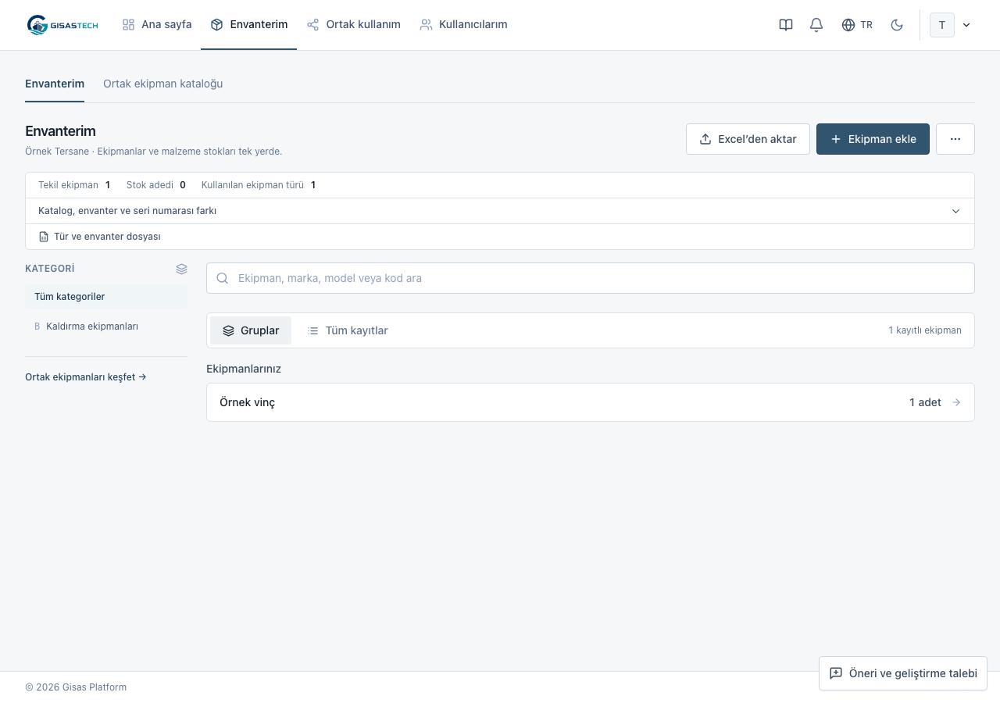
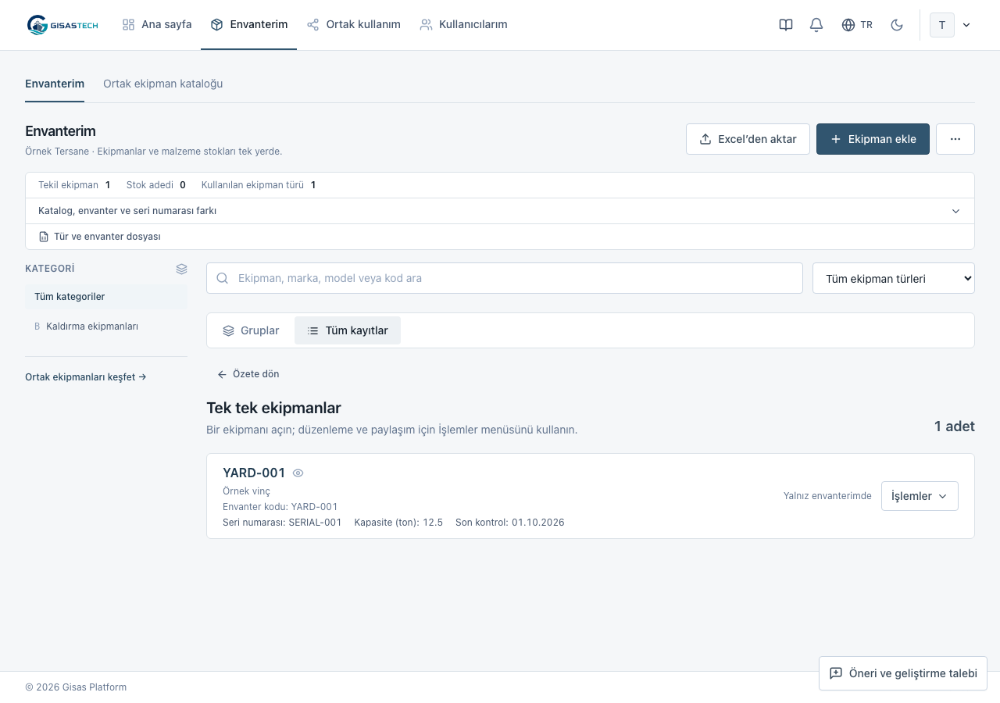

## 2. Ekipman ekle

1. **Envanterim → Ekipman ekle** seçin.
2. Ortak türü seçin. Platform hesabında sahibi aktif tersaneyi de seçin.
3. Bir ekipman için **Adet** değerini **1** bırakın. Aynı özellikte birkaç ekipman için artırın; her adet ayrı ekipman kaydı oluşturur. Adetli malzemede girilen miktar tek stok kaydında tutulur.
4. **Kataloğun istediği bilgiler** alanlarını doldurun. Diğer ayrıntılar için **İsteğe bağlı özellikler** bölümünü açın. Ayrı seri numaraları isteniyorsa her ekipmana ait değeri ayrı satıra yazın; gerçek seri numarası üretilmez.
5. Farklı özellikteki ekipmanlar için **Başka ekipman ekle** seçin. Alt özette tekil ekipman sayısı ile stok kaydı ve parça adedini ayrı kontrol edin; **Envantere ekle** seçin. Bütün kalemler birlikte kaydedilir.

Kurum içi envanter kodları otomatik atanır; kaydı **Düzenle** ile açıp değiştirebilirsiniz. Sonraki düzenlemelerde **Kaydet** kullanın. Tek işlemde en fazla 50 kalem ve 500 ayrı ekipman kaydı eklenebilir; daha büyük listeler için Excel kullanın.

Yeni kayıt özeldir; diğer tersanelere kendiliğinden açılmaz. Tür eksikse önce **Ekipman türleri** içinde arayın; uygun tanım yoksa platform yöneticisinden eklemesini isteyin. Aynı tersane ve tür içinde aynı envanter kodunu farklı kayıtlara vermeyin.

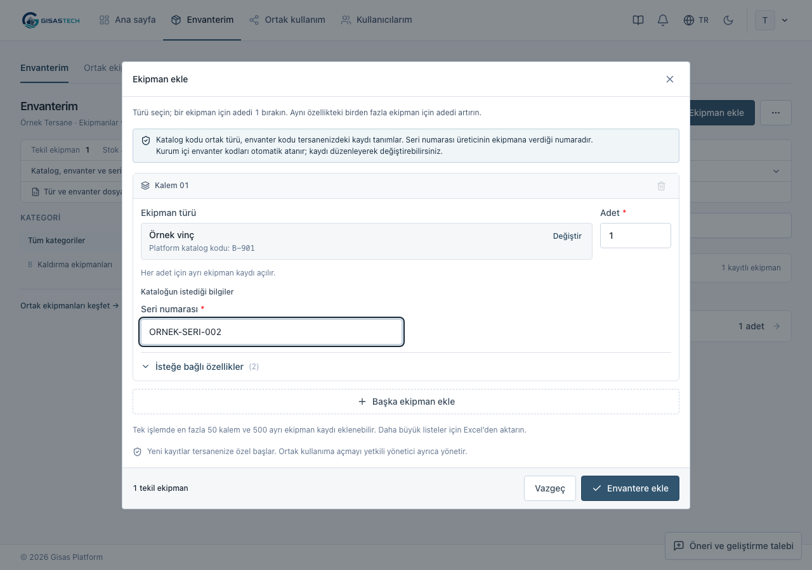

## 3. Türü ve bilgi alanlarını hazırla · Platform yöneticisi

1. **Ekipman türleri → Tür ekle** açın. Ortak adı, kategori ve ön paylaşım sınıfını seçin. Yeni türün katalog kodu boş bırakılırsa uygulama kod oluşturur; sonraki aktarımlarda bu kodu koruyun.
2. **Tek tek ekipman** veya **Adetli malzeme stoku** takip biçimini seçin. Envanteri olan türün takip biçimi değiştirilemez; farklı takip için yeni tür açın.
3. İhtiyaç duyulan alanları ekleyin. Yeni alanlar, stok için önerilen alanlar dahil, **isteğe bağlı** başlar. Gereksiz bilgileri zorunlu yapmayın.
4. **Bu bilgi ne için kullanılacak?** altında görevi seçin: **Kayıtları eşleştiren kod**, **Listede görünen ad**, **Toplam stok adedi** veya **Ek bilgi**. Stok adedi için sayı alanı kullanın. Görev seçmek alanı zorunlu yapmaz.
5. Mevcut türde zorunlu bilgi değiştirirken **Kaydetmeden önce kontrol** bölümündeki kayıt ve tersane sayılarını inceleyin; **Değişiklikleri uygula** ile tamamlayın.

Alan adı değişse de kalıcı alan kodu korunur; eski değerler silinmez. Mevcut bir alanı değiştirmek için aynı alanı düzenleyin. Yeni alan açarak eski alanın yerine geçirmeyin.

Yeni zorunlu alan eksikse kayıtlar **Güncelleme gerekli** olarak görünür. Etkilenen aktif tersane yöneticilerine, alan değişikliği başına toplu bildirim gider; her ekipman için ayrı bildirim üretilmez. Bildirimden eksik kayıtlara gidip tamamlayın. Bu eksikler giderilmeden yeni paylaşım, kullanım onayı ve teslim yapılamaz; sürmekte olan kullanımın iadesi kaydedilebilir.

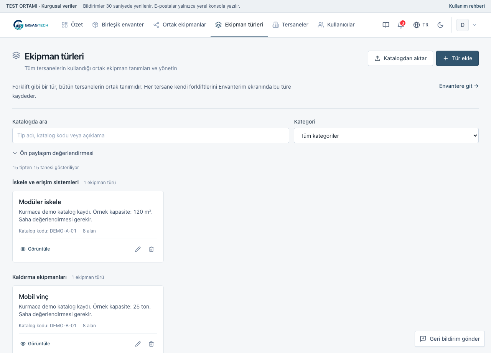

## 4. Tek Excel ile türleri ve envanteri aktar

Bu işlem farklı türleri ve seçilen tersanenin kayıtlarını aynı dosyada hazırlamak içindir.

1. **Envanterim → Excel’den aktar** açın. **Şablon gerekiyor mu? → Birleşik şablonu indir** seçin. Platform yöneticisi **Ekipman türleri → Katalogdan aktar** yolunu da kullanabilir. İlk kurulumda katalog veya tersane yoksa **Birleşik envanter → Excel’den aktar** doğrudan birleşik pencereyi açar; bu pencerede **Boş Excel şablonu indir** kullanın.
2. Dosyanın üç veri sayfasını doldurun. Başlıkları koruyun; veriler ikinci satırdan başlar. Dosyadaki **Rehber** sayfası sütunları açıklar.

| Sayfa | Her satır neyi tanımlar? | Bağlantı |
|---|---|---|
| Ekipman türleri | Ortak tür, kategori, takip biçimi ve ön sınıf | Katalog kodu |
| Alanlar | Türün bir bilgi alanı; adı, türü, görevi ve zorunluluğu | Aynı katalog kodu + kalıcı alan kodu |
| Envanter | Seçilen tersanenin ekipmanı veya stok kaydı | Aynı katalog kodu + yerel envanter kodu |

3. **Envanter** sayfasına, türlerin alan adı veya alan koduyla ek sütunlar açın. Farklı türlere ait olmayan hücreler boş kalabilir. Seçim alanı seçeneklerini **Alanlar** sayfasında `İyi|Bakımda|Kullanım dışı` gibi `|` ile ayırın. Yeni alanda **Zorunlu** boşsa alan isteğe bağlıdır.
4. Dosyayı seçip önizleyin. Birleşik yapı algılandığında **Bu dosyayı birleşik olarak incele** seçin; seçtiğiniz dosya taşınır, yeniden seçmeniz gerekmez. Platform hesabında envanter varsa **Envanterin ekleneceği tersane** seçin; sadece tür oluşturuyorsanız **Yalnızca ekipman türleri** kullanın. Tersane hesabında hedef kendi tersanenizdir. Dosyadaki tersane adı sahiplik atamaz.
5. **Dosyayı incele** seçin. Oluşturulacak/güncellenecek kayıtları, eski ve yeni değerleri, atlanan satırları ve seçim gereken satırları kontrol edin. Hata varsa dosyayı düzeltin. Tercih değişince yeniden inceleyin.
6. **Kontrol edilen kayıtları aktar** seçin. Sonucu ve envanterden birkaç kaydı doğrulayın.

Ortak tür ve alan değişiklikleri platform yöneticisine aittir. Tersane yöneticisi mevcut türlerin kodlarıyla kendi envanterini aktarabilir; tür ve alan sayfaları boş kalabilir. Yalnız tür içeren dosya fiziksel envanter oluşturmaz.

Bu akış dosyayı **birlikte uygular**: düzeltme gereken satır varsa hiçbir kayıt değişmez. Önizlemeden sonra ilgili kayıt değişmişse yeniden incelemeniz istenir. Her envanter satırında **Envanter kodu** veya türün seçilmiş eşleştirme alanı bulunmalıdır; ikisi de boşsa aktarım engellenir. Kod aynı tersane ve türdeki kaydı günceller; stok adedi eski değere eklenmez, onun yerine geçer. Benzer tür adları otomatik birleştirilmez. Aktarım hiçbir kaydı otomatik yayımlamaz.

### GISBIR taksonomi dosyası

Sağlanan dosya **13 kategori ve 175 ortak tür** içerir; gerçek tersane, ekipman kodu ve stok adedi içermez. Bu dosyayla tür kataloğu hazırlanabilir; gerçek envanter için ayrıca **Envanter** sayfasını doldurun.

Ana **1-TAKSONOMI** sayfası kullanılır; aynı kayıtları tekrarlayan kategori sayfaları ikinci kez aktarılmaz. **40. ve 57. Excel satırlarındaki B/C sınıfları** için açıkça seçim yapın, ardından **Dosyayı incele** işlemini tekrar çalıştırın. Kaynaktaki A–M harfleri kategori; kapasite birimleri stok adedi değildir. K kategorisinin kapsam dışı kuralı korunur. Ön A/B/C sınıfı saha uygunluğu onayı yerine geçmez.

### Mevcut tek tür dosyanı aktar

Kendi farklı düzenli Excel dosyanız için de **Envanterim → Excel’den aktar** kullanın. Dosya analizi sayfa, başlık satırı, ekipman türü ve sütun eşleşmelerini önerir. Belirsiz seçimleri tamamlayın; değişiklikten sonra **Dosyayı yeniden kontrol et** seçin. Şablon için aynı pencerede **Şablon gerekiyor mu?** bölümünü açın, ekipman türünü seçip **Tek tür şablonunu indir** kullanın. Bu şablonda gerçek veriler dördüncü satırdan başlar; ilk üç satırı ve gizli `_mapping` sayfasını koruyun.

Güvenle ayırt edilen toplam, ara toplam ve tekrarlanan başlıklar atlanır; satır numarası ve nedeni gösterilir. Sıfır adetli kalemler ve adında “toplam” geçen gerçek malzemeler korunur. Formül, yinelenen kod veya belirsiz değer varsa Excel’de düzeltin ya da ekranın izin verdiği kontrol satırlarını açıkça hariç tutun.

**Tek tür aktarımı satır bazındadır:** geçerli satırlar kaydedilmiş olabilir. Eşleştirme alanı olmayan türde aynı dosyayı tekrar aktarmak yeni kayıtlar oluşturabilir. **Oluşturuldu, Güncellendi, Atlandı, Hata** sonuçlarını okuyun; başarısız dosyayı körlemesine tekrar göndermeyin. Bu davranış üç sayfalı toplu aktarımın bütün dosyayı birlikte uygulamasından farklıdır.

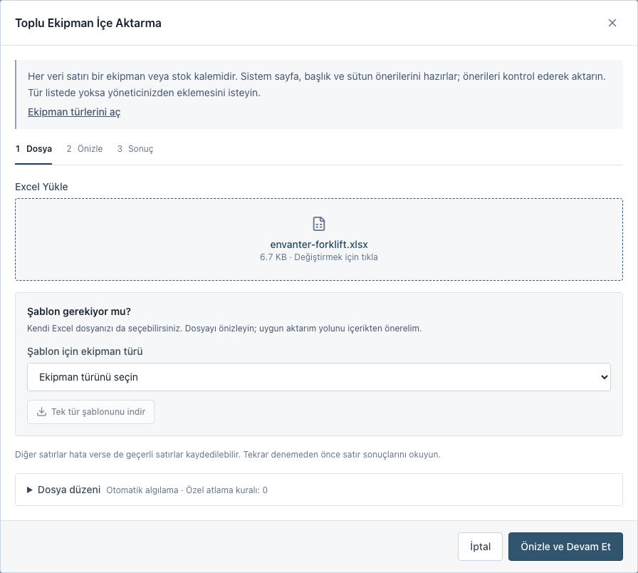
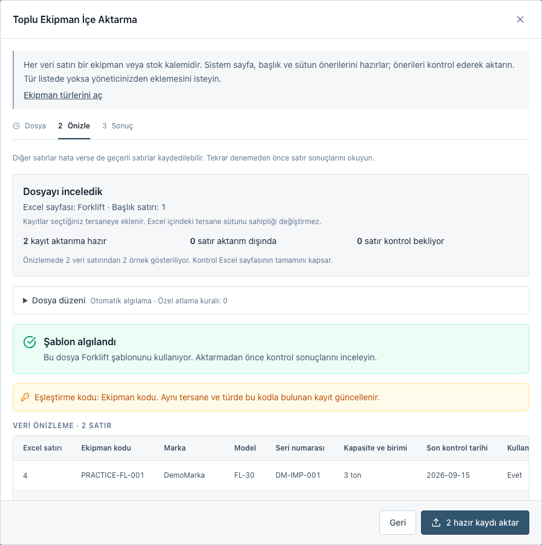

## 5. Ortak listeye aç veya geri çek

1. Envanterde ilgili kaydı bulun; **İşlemler → Paylaşımı yönet** açın.
2. **Bu ekipmanı diğer tersanelerin ortak listesinde göster** seçeneğini işaretleyin.
3. Ortak listede görünen adı, paylaşım adedini, kapasiteyi ve koşulları yazın. Kurmaca örnekte 500 parçanın 100 adedini paylaşabilirsiniz. Tek fiziksel ekipman kaydı bir adet paylaşır. Kullanım talebi alabilmek için paylaşım adedi belirtilmelidir; bilinmeyen stok adedi önce tamamlanır.
4. Uygunluk ve tarih notunu kontrol edin. İsterseniz yalnız paylaşmak istediğiniz kişinin adını, e-postasını ve telefonunu yazın. Hesap ve tersane iletişim bilgileri otomatik kopyalanmaz.
5. Karşı tersanenin göreceği önizlemeyi inceleyip **Kaydet** seçin. **Ortak ekipmanlar → Detayları gör** ile yayını kontrol edin.
6. Yayını geri çekmek için görünürlük seçimini kaldırıp **Ortak listeden kaldır** seçin. Envanter kaydı ve paylaşım taslağı korunur.

Diğer tersaneler yayınladığınız başlık, adet, kapasite, uygunluk, koşul ve iletişim bilgilerini görür. İç envanter kodu, özel teknik bilgiler, toplam stok ve atanan kişi açılmaz. Yayını tersane yöneticisi veya yetkili platform hesabı yönetir; personel değiştiremez. Kullanım onayını ise yalnız sahibi tersane verir.

K kategorisi, C ön sınıfı, kapsam dışı nedeni veya eksik zorunlu bilgileri bulunan kayıt yeni paylaşıma açılamaz. Pasif tersane gizlenir. Yayını geri çekmek yeni talepleri durdurur; mevcut onay ve teslim geçmişini silmez.

Stok paylaşım adedinin altına düşerse veya tür değiştirilirse yayın durur; taslak korunur. Stok artınca otomatik yeniden yayımlanmaz. Açık talep varsa sahibi/türü değiştirmek veya kaydı silmek engellenir. Onaylanan ya da teslim edilen adedin altına stok veya paylaşım adedi düşürülemez.

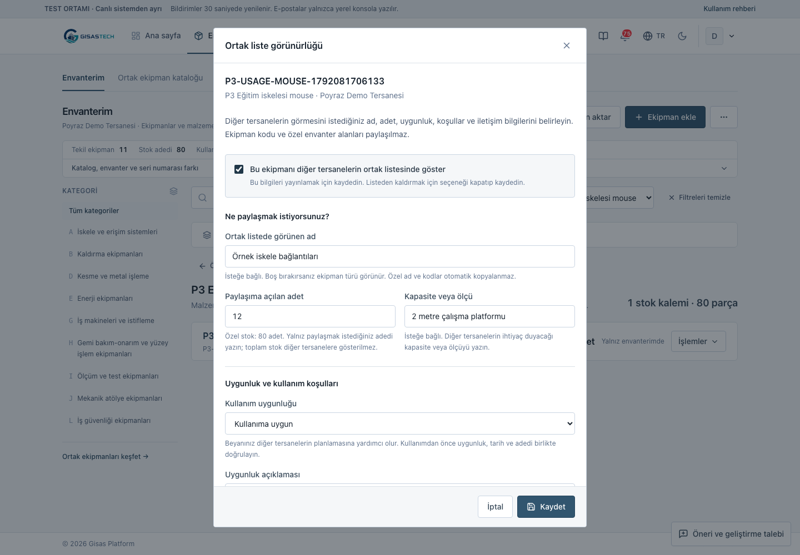
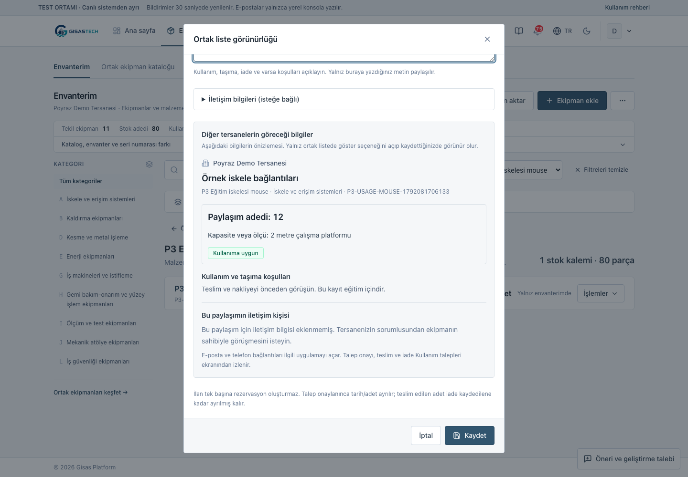

## 6. Bedelsiz kullanım talebi gönder ve takip et

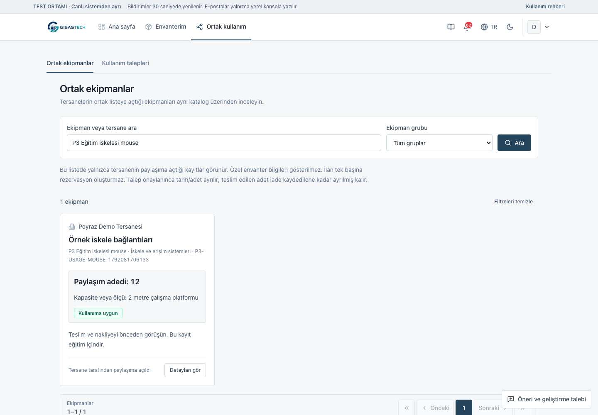

1. **Ortak ekipmanlar** listesinden başka tersanenin uygun ekipmanını açın; **Bedelsiz kullanım talebi** seçin. Kendi tersanenizin ekipmanı için talep gönderilmez.
2. Başlangıç tarihi, iade tarihi ve istediğiniz adedi yazın; isterseniz kullanım amacını ekleyin. Başlangıç ve iade günü süreye dahildir. **Talebi gönder** seçin.
3. **Ortak kullanım → Kullanım talepleri → Tersanemizin talepleri** bölümünden sonucu izleyin. Liste yalnız sizin gönderdiklerinizi değil, tersanenizin taleplerini gösterir. **Talebi oluşturan**, sonraki işlem ve sorumlu rolü kontrol edin. Henüz onay bekleyen talep ekipman ayırmaz.
4. Sahibi tersane yöneticisi **Gelen talepler** bölümünde **Talebi aç → Onayla** veya **Reddet** kullanır. Açılan işlem bölümüne açıklama ekleyebilir; **İşlemi tamamla** ile kararı kaydeder. Platform yöneticisi tersane adına onay vermez.
5. Onaylanan adet tarih aralığı için ayrılır. Ekipmanı teslim ettiğinde sahibi yönetici **Teslim et** seçip **İşlemi tamamla** ile kaydeder. Teslim başlangıç tarihinde veya sonrasında yapılır.
6. Ekipman geri geldiğinde sahibi yönetici **İade al** seçip **İşlemi tamamla** ile kaydeder.

Durumlar: **Onay bekliyor → Onaylandı → Teslim edildi → İade alındı**. **Reddedildi** ve **İptal edildi** talepleri kapatır. Talebi gönderen kişi veya kendi tersane yöneticisi teslim öncesinde iptal edebilir; sahibi yönetici de onaylanan talebi iptal edebilir. Teslim edilmiş talep iptal edilmez; iade kaydedilir.

Tarih geçmiş olsa bile teslim edilmiş ekipman, iade kaydedilene kadar ayrılmış kalır. Çakışan tarihlerde eldeki paylaşım adedinden fazlası onaylanamaz. Onaylanan tarihler geçmişse yeni talep hazırlayın. İlgili iki tersane talep ayrıntılarını görür; durum değişiklikleri ilgili kişilere bildirilir. Kullanım amacı ve özel envanter bilgileri e-posta bildirimine eklenmez.

Taşıma, operatör, muayene ve saha uygunluğunu ayrıca teyit edin. Uygulama belge geçerliliğini veya mühendislik uygunluğunu kendiliğinden doğrulamaz.

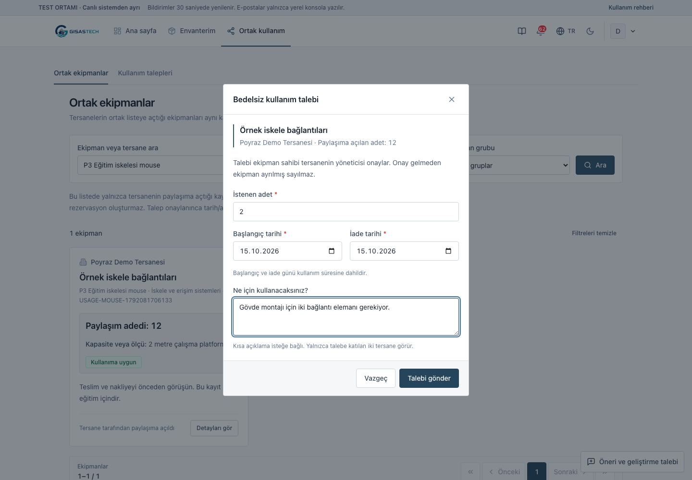
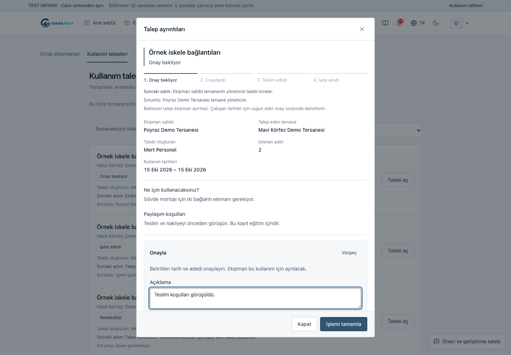
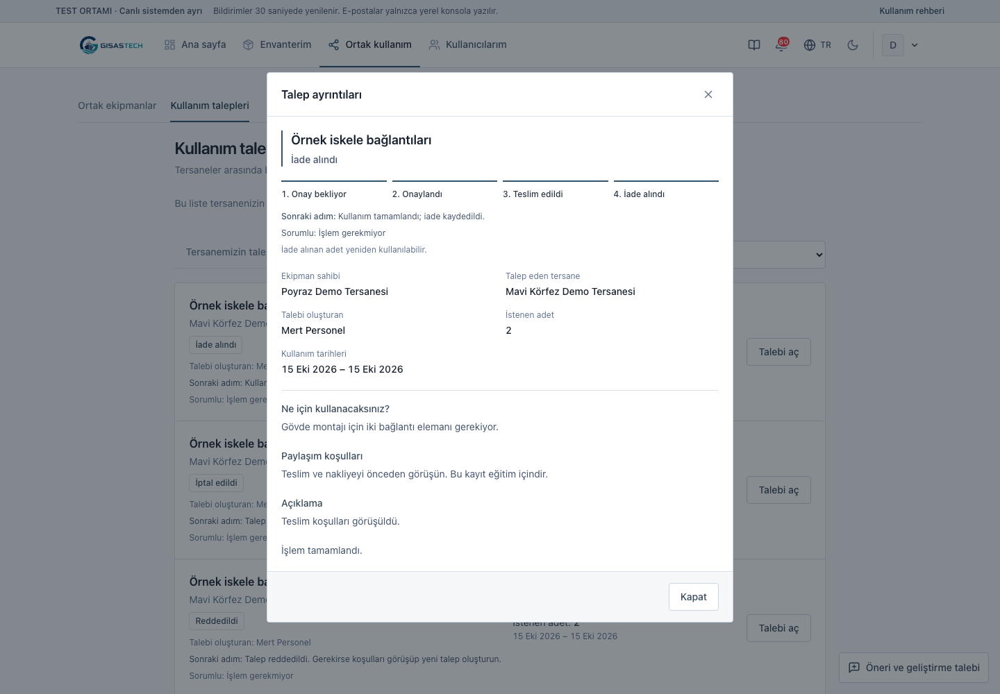

## 7. Çözüm önerisi veya geliştirme talebi gönder

1. Giriş yaptıktan sonra hesap menüsünden **Çözüm önerileri ve geliştirme talepleri** açın. Sağ alttaki **Yeni talep** düğmesi de aynı formu açar.
2. **Sorun bildirimi**, **Geliştirme talebi** veya **Çözüm önerisi** seçin. Konuyu kısa yazın; **İhtiyaç veya yaşanan sorun** alanında yaşadığınız ihtiyacı ve hangi ekranda oluştuğunu anlatın.
3. İsterseniz **Çözüm ve fayda ekle (isteğe bağlı)** bölümünü açın. **Çözüm öneriniz** ve **Beklenen fayda** ayrı alanlardır; öneri bulmadan da talep gönderebilirsiniz.
4. Gerekirse dosya ekleyin: en fazla 5 dosya, dosya başına 5 MB, toplam 15 MB. Resim, PDF, metin/CSV, Excel ve Word dosyaları desteklenir.
5. **Talebi gönder** sonrasında **Talebi takip et** seçin. **Taleplerim** listesinden durumunu, yanıtları ve geçmişini görün; **Yanıtınız → Yanıtı gönder** ile bilgi ekleyin.

Talepleriniz yalnız size ve platform yöneticilerine görünür. Aynı tersanedeki diğer kullanıcılar veya başka tersaneler talebinizi ve eklerini okuyamaz. Sistem ekranın güvenli yolunu kaydeder; adresin sorgu parametreleri ve bağlantı parçası kaydedilmez.

Platform yöneticisi **Gelen tüm talepler** içinde arama ve filtrelerle kayıtları bulur. **Talebi aç → Değerlendirme** bölümünde durum, öncelik ve platform sorumlusu seçilir; açıklama veya yanıt eklenebilir. Kullanıcı bu yönetim alanlarını değiştiremez. Liste 24 kayıtlık sayfalara ayrılır.

Durumlar: **Yeni**, **Değerlendiriliyor**, **Planlandı**, **Üzerinde çalışılıyor**, **Tamamlandı**, **Uygulanmayacak**. Durum ve sorumlu değişiklikleri geçmişte tutulur. Yeni talep ve kullanıcı yanıtı ilgili platform yöneticilerine; değerlendirme ve yönetici yanıtı talep sahibine bildirilir. Bildirim e-postası talebin açıklamasını veya eklerini içermez; ayrıntı için giriş yapılır. Yerel testte e-posta dışarıya gönderilmez.

Art arda çok sayıda işlemde gönderim sınırı uyarısı görünür. Bir süre bekleyip yeniden deneyin; formda yazdıklarınız ve seçilen dosyalar korunur. Talepleri okumaya devam edebilirsiniz.

## 8. Envanteri dışa aktar

1. Envanterde **Diğer İşlemler** menüsünü açın; **Görünen sonuçlar (CSV)** veya **Seçilen türün tamamı (Excel)** seçin. **Envanteri dışa aktar** penceresinde kapsamı kontrol edin.
2. **Görünen sonuçlar (CSV)**, geçerli arama ve filtrelere uyan **bütün sayfalardaki** kayıtları içerir. Penceredeki kayıt sayısını kontrol edip **CSV indir** seçin.
3. **Seçilen türün tamamı (Excel)** için ekipman türünü seçin. Bu yol erişebildiğiniz o türün bütün kayıtlarını içerir; mevcut arama, kategori, model ve güncelleme filtreleri uygulanmaz. Platform hesabında hedef tersane kapsamını da kontrol edin; **Excel indir** seçin.

Tersane hesabı yalnız kendi tersanesinde erişebildiği kayıtları dışa aktarabilir. Boş Excel şablonu kayıt çıktısı değildir; **Excel’den aktar → Şablon gerekiyor mu?** bölümünden indirilir. Formül gibi başlayan kullanıcı metinleri çıktıda metin olarak korunur.

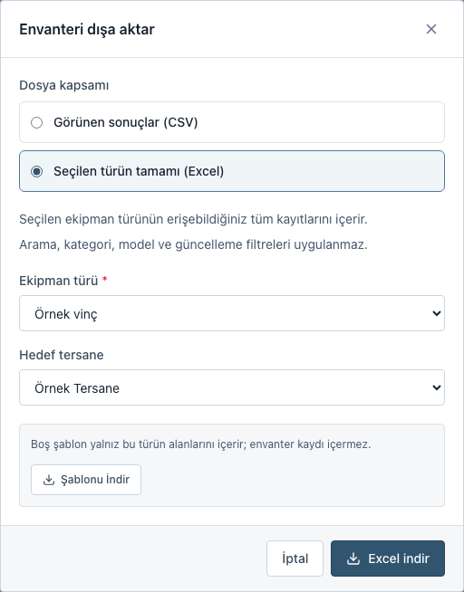

## 9. Kullanıcı oluştur ve tersaneye ata · Platform yöneticisi

1. **Yönetim → Kullanıcılar → Yeni Kullanıcı Oluştur** açın. Kimlik bilgilerini ve parolayı girin.
2. **Tersane** alanında bir tersane veya **Şimdilik atamasız** seçin. Atamasız hesap, atanana kadar tersane envanterine erişemez. Pasif tersane seçilirse kullanıcı, tersane etkinleştirilene kadar envantere erişemez.
3. Tersane seçtiyseniz rolü belirleyin. Tersane yöneticisi o kurumun kullanıcılarını ve kullanım taleplerini yönetebilir; personel kurumun envanterinde çalışabilir ve talep gönderebilir, yönetici onayı veremez.
4. **Kullanıcıyı gözden geçir** seçin. Kullanıcı henüz kaydedilmemiştir; tersane, rol ve erişim etkisini doğrulayın. Parola özette gösterilmez.
5. **Kullanıcıyı oluştur ve ata** seçin. Atamasız durumda düğme **Kullanıcıyı oluştur** olur. Oluşturma ve atama tek işlemde tamamlanır. Hata olursa bilgiler korunur; düzeltip yeniden deneyin.

Bu akış yalnız yetkili genel yönetim hesabındadır. Tersane yöneticisinin kullanıcı ekranı kendi tersanesiyle sınırlıdır; başka tersaneye atama veya platform yetkisi vermez.

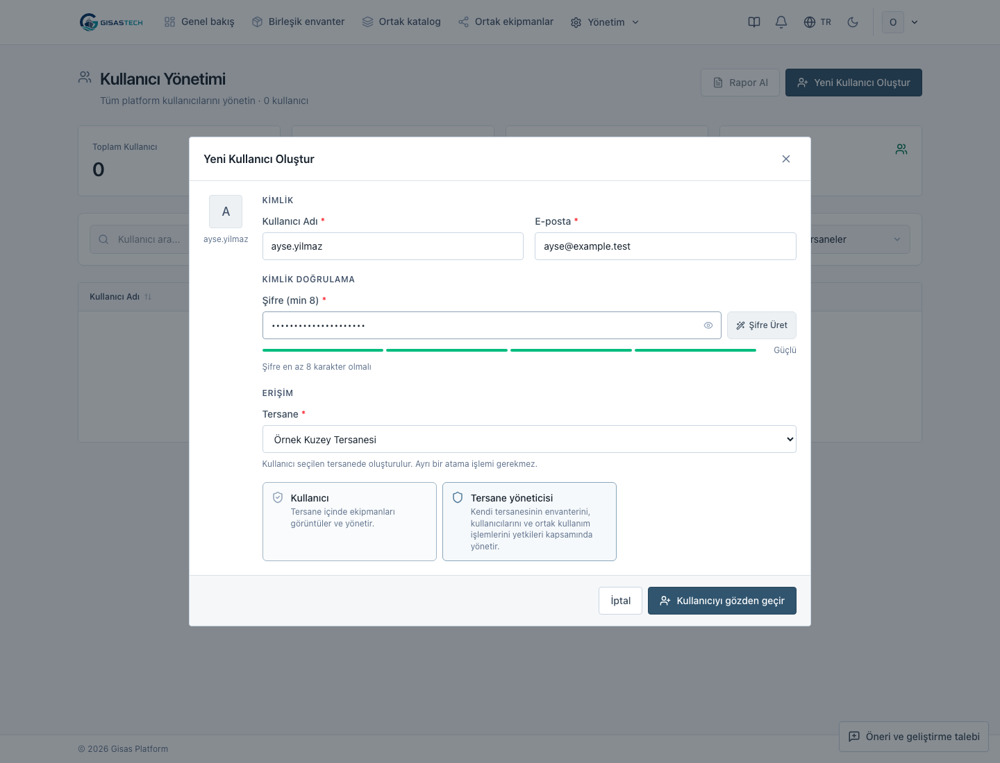
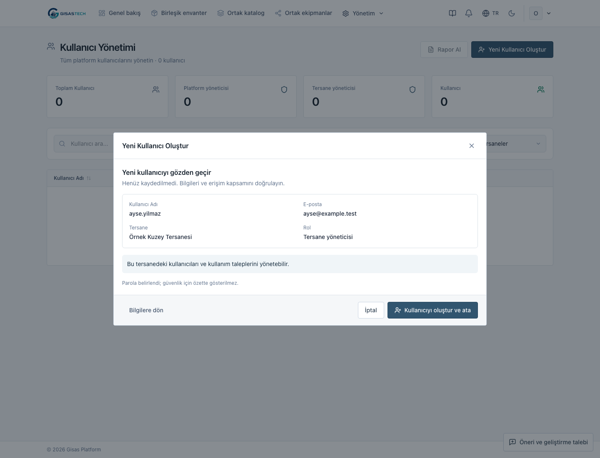

## Takıldığınızda

**Güncelleme gerekli:** Eksik bilgili kaydı açıp işaretlenen zorunlu alanları tamamlayın. Bildirim geldiğinde her kaydı ayrı ayrı yeniden oluşturmayın.

**Aktarım tamamlanmadı:** Satır numarası ve hata nedenini okuyun. Üç sayfalı dosyayı yeniden inceleyin; tek tür aktarımında başarılı kayıtların kaydedilmiş olabileceğini kontrol edin.

**Talep düğmesi yok:** Kendi tersanenizin ilanı, paylaşım adedi belirtilmemiş kayıt veya kullanıma kapalı ilan için talep gönderilemez. Ortak kullanım ortamda henüz açılmamışsa sistem yöneticisi yapılandırmayı kontrol eder.

**Adet değişikliği engellendi:** Önce açık kullanım taleplerini inceleyin. Teslim edileni iade almadan onun adedini yeniden kullanılabilir saymayın.

Kurmaca hesaplar ve deneme adımları: [TEST_ORTAMI.md](TEST_ORTAMI.md). Veri modeli ve kalan ihtiyaçlar: [GISBIR_SSRP_GAP_ANALIZI.md](GISBIR_SSRP_GAP_ANALIZI.md).
