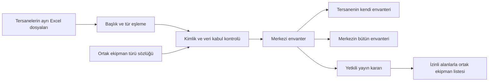

# Tersanelerin merkezi envanteri ve ortak ekipman listesi

14 Ekim 2026 · Kullanıcının açıkladığı ürün amacı ve mevcut kaynak kodu üzerinden analiz

## Ürünün amacı

Ürün, tersanelerin ayrı dosyalarda tuttuğu araç ve gereçleri tek merkezde, aynı tanımlarla kaydetmesini sağlar. Bir kayıt için üç sorunun cevabı açık olmalıdır: **Bu ekipman nedir, hangi tersaneye aittir, ortak listede gösterilmesine izin verilmiş midir?**

Kullanıcının görünürlük kararı: **yalnız sahibi tersanenin açıkça yayımladığı ekipman ortak listede görünür.** Merkezi depolama, tersanenin bütün özel kayıtlarını diğer tersanelere açmaz. Bu kararın kontrollü listeleme katmanı bu çalışmada uygulandı. Aşağıda mevcut işlevler ile kalan veri kalitesi ve işletme ihtiyaçları ayrı gösterilir.

Bu amaca göre ilk ürün; merkezi envanter, standart ekipman türleri, güvenilir Excel aktarımı ve kontrollü ortak listeleme etrafında kurulmalıdır. Rezervasyon, teslim/iade, kiralama ve ödeme ayrı geliştirme aşamalarıdır. Listeleme ürünü bu işlemler olmadan değer sağlayabilir; arayüz bunları varmış gibi sunmamalıdır.

Önceki [SSRP GAP raporunda](GISBIR_SSRP_GAP_ANALIZI.md) rezervasyon ve tahsis için verilen öncelikler tam ortak kullanım operasyonu içindir. Bu belgedeki öncelikler **merkezi envanter ve listeleme MVP'si** içindir; iki kapsamın öncelikleri birbirine karıştırılmamalıdır.

## Mevcut sistemin ürünle uyumu

Temel veri ayrımı doğru kurulmuş: global `AssetType` bütün tersanelerin kullanacağı ortak tanımı ve takip biçimini belirler; `Asset` belirli bir tersaneye ait ekipman veya malzeme stok kaydıdır. Tersaneler aynı forklift türünü kullanır, kendi forkliftlerini ayrı kaydeder. İskele malzemesinde ise bir kayıt aynı malzemenin stok miktarını tutar. Sahiplik için `Asset.tenant` kullanılır. [Modeller](../backend/apps/assets/models.py#L8)

Merkezi depolama ile tersaneler arasında görünürlük farklıdır. Merkez yöneticisi bütün ekipmanları sorgulayabilir. Normal tersane kullanıcısı özel envanter ekranında yalnız kendi tersanesinin ekipmanlarını görür; ayrı **Ortak ekipmanlar** ekranında diğer tersanelerin açıkça yayımladığı sınırlı bilgileri bulabilir. Bütün kullanıcıların aynı tür listesini görmesi ise yalnız ortak sözlük kullanımıdır. [Özel envanter sorgusu](../backend/apps/assets/views.py#L224), [ortak liste sorgusu](../backend/apps/assets/views.py#L254), [ortak tür sorgusu](../backend/apps/assets/views.py#L42)

| Ürün ihtiyacı | Bugünkü karşılığı | Sonuç |
|---|---|---|
| Bütün tersane envanterlerinin aynı sistemde tutulması | Tek `Asset` modeli; her kayıtta sahibi `tenant` | Var |
| Tersanelerin aynı ekipman tanımını kullanması | Global `AssetType`, katalog kodu, kategori ve teknik alanlar | Var; kontrollü kaynak sözlüğü ve değişiklik yönetimi geliştirilmeli |
| Her tersanenin kendi kayıtlarını yönetmesi | Kurumla sınırlandırılmış liste ve yazma doğrulaması | Var; personel ile yönetici arasında ekipman yazma/silme ayrımı yok |
| Merkezin envanterleri topluca incelemesi | Superuser / `platform_admin` bütün ekipmanları görür | Var |
| Tersanelerin birbirlerinin izinli ekipmanlarını araması | Ayrı ortak liste; sunucu araması, kategori filtresi ve 24 kayıtlık sayfalar | Var; yapılandırılmış kapasite ve iletişim bilgileri sonraki ihtiyaç |
| Bir ekipmanın ortak listeye açılması/kapatılması | Varsayılan özel `is_shared`; yöneticinin ayrı yayın işlemi; açık paylaşım notu | Var; personel yayın kararını değiştiremez |
| Ekipmanın gerçekte boşta veya kullanıma hazır olduğunu bilme | Ekipmanda operasyonel durum, müsaitlik veya tarihli doğrulama yok | Eksik; katalog sınıfından çıkarılamaz |
| Farklı Excel dosyalarından ortak kayıt üretme | Şablon aktarımı ve sütun eşlemeli aktarım | Var; kimlik garantisi ve tam dosya kabul kontrolü eksik |

**Bugünkü ürün tarifi:** merkezde birleşen, tersane sahipliği korunmuş envanter; ortak tür sözlüğü; sahip tersanenin yetkili kararıyla açılan, sınırlı ortak ekipman listesi. Sonraki temel ihtiyaçlar; güvenilir ekipman kimliği, kaynak Excel kabulü, yapılandırılmış teknik arama ve bakımını sürdürebilen veri yönetimidir.

### Bu çalışmada tamamlanan dilim

| Bileşen | Uygulanan davranış | Kaynak |
|---|---|---|
| Envanter görünümü | Tek tek ekipmanlarda tür/marka/model özeti ve ayrı kayıt listesi; adetli stokta malzeme adı/kodu ve stok miktarı; kalem sayısı ile parça toplamı ayrı | [Envanter ekranı](../frontend/src/routes/_secured/assets/index.tsx) |
| Stok takibi | Türde açık takip biçimi; zorunlu malzeme kodu/adı ve sıfır veya pozitif tam sayı stok; form ve iki Excel yolunda aynı doğrulama | [Modeller](../backend/apps/assets/models.py), [doğrulama](../backend/apps/assets/validation.py) |
| Tür sözlüğü görünümü | Kategorilere göre tür dizini; tür seçimi, açıklaması ve girilecek alanların detayları | [Tür ekranı](../frontend/src/routes/_secured/assets/types.tsx) |
| Yayın kararı | Varsayılan özel; `is_shared`, en fazla 1.000 karakterlik `sharing_note`, `shared_at`; ayrı PATCH işlemi | [Model](../backend/apps/assets/models.py#L84), [yayın serializer'ı](../backend/apps/assets/serializers.py#L179) |
| Yetki | Aktif tersane yöneticisi yalnız kendi ekipmanını yayımlar; merkez yetkilileri denetim kapsamında erişir; personel yayın değiştiremez | [Yayın işlemi](../backend/apps/assets/views.py#L280) |
| Ortak liste | Yalnız yayımlı, sahibi aktif ve türü kapsam içinde olan kayıtlar; sınırlı alanlar; arama ve sayfalama | [Ortak liste API'si](../backend/apps/assets/views.py#L254), [ortak ekran](../frontend/src/routes/_secured/shared-equipment.tsx) |
| Özel veri koruması | Ortak çıktıda `custom_data`, iç ekipman kodu/seri numarası, atanan kişi ve oluşturan yok; başka kurumun özel detay erişimi korunur | [Sınırlı çıktı](../backend/apps/assets/serializers.py#L207) |
| Excel ve normal kayıt | Yayın alanları genel CRUD/Excel yollarında yazılamaz; yeni ekipman özel başlar, import yayın kararı vermez | [Asset serializer](../backend/apps/assets/serializers.py#L108) |
| Sahiplik ve eşzamanlı güncelleme | Sahip tersane değişince yayın izni, not ve yayın tarihi sıfırlanır; güncelleme güncel satırı kilitler, daha yeni yayından kaldırma kararını geri getirmez | [Güncelleme](../backend/apps/assets/serializers.py#L161) |

Backend doğrulaması: **110 test geçti**; stok, demo izolasyonu ve ortak liste/yayın kontrolleri dahil. Varsayılan demo 83 ayrı ekipman ve 3 yayın içerir. Kullanıcının özel olarak sağladığı kaynak dosyayla ek stok kabulü de izole yerel ortamda kontrol edildi; kaynak değerleri ve kayıt dökümü özel yerel notlarda tutulur. Bu belgedeki stok örneği kurmacadır: 3 stok kalemi, toplam 750 parça. Güncel tarayıcı/build sonuçları [VERIFICATION.md](VERIFICATION.md) üzerinden izlenmelidir.

## Kullanıcının anlayacağı kavramlar

Arayüzde teknik `Asset`, `AssetType`, `schema`, `tenant` dili yerine günlük iş dili kullanılmalıdır.

| Kavram | Kullanıcı adı | Örnek | Ne değildir? |
|---|---|---|---|
| Kategori | Ekipman grubu / kategori | İş makineleri ve istifleme | Fiziksel ekipman veya paylaşım kararı |
| `AssetType` | Ekipman türü | Dizel forklift | Tersanenin elindeki tek forklift |
| `Asset` | Ekipman | Mavi Körfez Tersanesi · FL-001 · 3 ton | Global katalog tanımı |
| `catalog_code` | Tür kodu | G-001 | Seri numarası veya tersane ekipman kodu |
| Şemadaki tekil alan | Ekipman kodu / tanımlayıcı | FL-001 | Bugün veritabanınca garanti edilen tekillik |
| `sharing_class` | Türün ön paylaşım değerlendirmesi | Çok uygun / koşullu uygun / uygun değil | Bu fiziksel ekipman için yayın izni veya müsaitlik |
| `assigned_to` | Sorumlu kişi | Aynı tersanedeki bir kullanıcı | Başka tersaneye teslim veya sahiplik devri |

G-001 örneği ürünün iç tür kodudur; PDF'nin özgün satır kodu olarak sunulmaz. Kategori kodu A ve paylaşım sınıfı A iki ayrı alan olduğundan yalın harf rozetleriyle anlatılmamalıdır.

**Basit anlatım:** “Ekipman türü, hangi bilgilerin girileceğini belirler. Ekipman, tersanenizin bu türe ait gerçek kaydıdır.” Forklift türündeki kapasite alanını bütün tersaneler kullanır; her tersane kendi ekipman kodunu ve kapasitesini girer.

## Ekranların görevleri

### Envanterim

Yeni başlangıç, tek tek izlenen ekipmanlarda aynı tür/marka/modeli birlikte gösterir: “Forklift · Toyota 8FD · 50 adet”. Kullanıcı “Listeyi aç” ile her ekipmanın koduna ve ayrı detayına ulaşır; düzenleme, paylaşma ve silme “İşlemler” altında açılır. Bu takip biçiminde 50 adet, 50 ayrı fiziksel kaydın sayısıdır. Farklı markalar/türler birleştirilmez, eksik model açıkça belirtilir.

Adetle tutulan stok için ayrı takip biçimi kullanılır. Kurmaca örnekte 3 satır ve toplam 750 parça vardır: `ORNEK-STOK-01` yürüme platformu 500, `ORNEK-STOK-02` bariyer 250, `ORNEK-STOK-03` diyagonal eleman 0 adet. Bunlar gerçek envanterden alınmış değerler değildir. Platform satırı 500 parçayı tek stok kaydında temsil eder; parçaların ayrı seri kayıtları yoktur. Stok görünümü **malzeme adı → malzeme kodu → stok adedi** sırasını kullanır; olmayan marka/modeli kullanıcıya sormaz. Tek kayıt doğrudan ayrıntıya açılır. Merkezde her stok satırının sahibi tersane gösterilir. Aynı yerel kod başka tersanede farklı malzemeyi anlatabilir; bu yüzden stok kayıtları tersaneler arasında otomatik birleştirilmez. Ortak malzeme sözlüğü ve tersanelerin yerel kodlarını ortak tanıma bağlayan eşleme açık GAP olarak kalır.

Ekranın günlük iş ilkeleri:

- İlk satır: sayfa adı, tersane bağlamı ve tek bir ana işlem — **Ekipman ekle**.
- Arama: ekipman kodu, tür adı, marka/model; tür filtresi erişilebilir. Diğer filtreler ihtiyaç olduğunda açılır.
- Kayıt özeti: önce ekipman kodu ve tür, sonra marka/model ve kapasite. Tersane personeline her satırda zaten bilinen tersane adı tekrarlanmaz; merkez yöneticisinde sahip tersane görünür.
- Teknik özelliklerin tamamı seçilen kaydın detayında görünür. Ham JSON veya şemanın her alanı liste sütunu yapılmaz.
- İçe aktarma ve dışa aktarma ana işlemi bastırmayan ikincil işlemlerdir.
- Boş envanterde örnek akış; filtre sonucu boşsa filtre temizleme; yükleme hatasında tekrar deneme gösterilir.
- Mobilde kod ve tür ilk bakışta okunur; işlemler yatay kaydırmaya bağlı bırakılmaz.

“Varlıklarım” teknik ve geniş bir başlıktır. “Envanterim” kullanıcı görevini daha iyi anlatır. Merkez yöneticisi için “Merkezi envanter” aynı verinin geniş kapsamını açıklar.

### Ekipman türleri

Ekran kategorilere göre tür dizini olarak yeniden düzenlendi. “Hangi ekipman türünü kullanmalıyım?” sorusuna cevap verir; türün teknik detayları seçildiğinde açılır. Günlük kullanım ilkeleri:

- Görünen temel bilgi: tür adı, kategori, kısa açıklama ve gerektiğinde tür kodu.
- Tür seçildiğinde girilecek bilgilerin anlaşılır özeti: “Ekipman kodu, marka, model, kapasite”.
- Türün ön paylaşım değerlendirmesi detayda bağlamıyla gösterilir. “A” rozetinin tek başına “kullanıma hazır” izlenimi vermesine izin verilmez.
- Tür oluşturma, alan şeması düzenleme ve katalog Excel aktarımı yönetici işidir. Normal kullanıcı bu teknik işlemlerle karşılaşmaz.
- Yeni tür önerme ihtiyacı ileride ayrı bir öneri/onay akışıyla karşılanabilir; her tersanenin benzer isimli global tür açması standardı bozar.

### Ortak ekipmanlar

Ortak liste ayrı `/shared-equipment` ekranında sunulur. Burada kullanıcı “hangi tersanede ihtiyacım olan ekipman listelenmiş?” sorusunu sorar. Sunucu araması tür, sahibi tersane ve açık paylaşım notunu kapsar; kategori filtresi ve 24 kayıtlık sayfalama vardır. Backend ayrıca tersane ve tür kimliğiyle filtrelemeyi destekler; mevcut ekranda kategori ve metin araması gösterilir.

Bugünkü sonuç özeti: ekipman türü, sahibi tersane, kategori/tür kodu, paylaşım notu ve yayın tarihi. Ortak API alanları `id`, `tenant`, `tenant_name`, `asset_type_name`, `category_code`, `catalog_code`, `sharing_note`, `shared_at` ile sınırlıdır. Yapılandırılmış kapasite ve iletişim yöntemi henüz bu çıktıda yok; notta serbest metin olarak anlatılabilir. İç notlar, sorumlu kişinin kullanıcı kimliği, seri numaraları ve özel teknik alanlar otomatik yayımlanmaz.

**Görünürlük:** yalnız açıkça yayımlanan ekipman; sahibi tersane aktif olmalı ve tür kapsam dışı olmamalı. K kategorisi, C ön sınıfı veya açık dışlama gerekçesi yayını engeller; önceden yayımlanan kayıt da bu koşullar değişince ortak listeden çıkar. `is_listed_for_sharing`, saklanan yayın kararından ayrı etkin görünürlüğü verir. Kimliği doğrulanmış aktif tersane üyeleri ve yetkili merkez kullanıcıları listeyi okuyabilir. Liste, anonim internete açılmış kamu kataloğu değildir.

Yayın tarihi ekipmanın teknik bilgilerinin son doğrulanma tarihi değildir. “Listelenmiş” etiketi, “müsait”, “rezerve edilebilir” veya “güvenlik değerlendirmesi tamam” anlamına gelmez.

## Rol ve yetki analizi

| Rol | Bugünkü ekipman kapsamı | Tür yönetimi | Ortak yayın kararı | Önemli fark |
|---|---|---|---|---|
| Django superuser | Bütün tersaneler; kayıt oluşturma/düzenleme/silme ve import | Var | Aktif hesapla var | Tersane ve genel kullanıcı yönetiminde de yetkili |
| `platform_admin` | Bütün tersaneler; ekipman CRUD ve import | Var | Aktif hesapla var | Platform rota koruması ve genel tersane yönetimi superuser gerektirir; aynı etiket eşit kapsam değildir |
| `tenant_admin` | Aktif kendi tersanesinde ekipman CRUD ve import | Yok | Aktif hesapla kendi tersanesinde var | Kendi tersane kullanıcı yönetiminde belirli işlemler mevcut |
| `tenant_user` | Aktif kendi tersanesinde ekipman CRUD ve import | Yok | Yok; ortak listeyi okuyabilir | Yayın bakımından salt okunur; ekipman kaydı bakımından silme dahil yazma izinleri sürer |
| Kurumsuz / pasif kurum üyesi | Normal üye ekipman erişimi reddedilir | Kimliği doğrulanmış kullanıcı global türleri okuyabilir | Yok; ortak listeye de erişemez | Kimlik, kurum üyeliği ve katalog okuması ayrı kontroller |

Kaynak: [IsTenantMember](../backend/apps/tenants/permissions.py#L38), [ekipman viewset](../backend/apps/assets/views.py#L213), [yayın yetkisi](../backend/apps/assets/views.py#L280), [serializer kurum kontrolü](../backend/apps/assets/serializers.py#L129), [tür yazma kontrolü](../backend/apps/assets/views.py#L46), [tersane yetkileri](../backend/apps/tenants/views.py#L46), [platform rota koruması](../frontend/src/routes/_secured/platform/route.tsx#L4).

Yayın yetkisi artık ekipman yazma yetkisinden ayrıdır: personel envanter düzenleyebilir, fakat ortak listeye açma/kapatma kararı veremez. Kalan rol işi görüntüleme, ekipman oluşturma/düzenleme, silme ve Excel kabulünü kendi içinde ayırmaktır. Personelin envanter bakımından yalnız okuyup okuyamayacağı kullanıcı kararıdır; mevcut kapsam bu çalışmada sessizce daraltılmadı.

## Envanterleri birleştirirken kimlik ve mükerrer kayıt

### Bugünkü eşleme

Ekipmanın sistem UUID'si var. Excel aktarımı, tür şemasında `is_unique_key` işaretli bir alan varsa **tersane + tür + alan değeri** ile mevcut kaydı arar ve bulduğu ilk kaydı günceller. Başka tersanenin aynı kodlu ekipmanı etkilenmez. Şablonun tekrar aktarımı ve başka tersanenin aynı kodunu koruma testleri mevcut. [Şablon eşlemesi](../backend/apps/assets/views.py#L391), [serbest Excel eşlemesi](../backend/apps/assets/views.py#L648), [regresyon](../backend/apps/assets/tests.py#L167)

| Örnek | Bugünkü sonuç | Ürün açısından yorum |
|---|---|---|
| Mavi Körfez · Forklift · FL-001 tekrar Excel'e gelir | Mevcut kayıt güncellenir; tekil alan tanımlıysa | Doğru temel davranış |
| Poyraz · Forklift · FL-001 gelir | Poyraz'da ayrı kayıt | Doğru; tersanelerin yerel kodları çakışabilir |
| Aynı tersanede FL-001 farklı tür seçilerek içeri alınır | Ayrı kayıt oluşabilir | Tür eşleştirme hatası fiziksel mükerrer üretebilir |
| Aynı kod elle tekrar oluşturulur | Serializer tekillik kontrolü yapmaz | UI formu ve import aynı kimlik politikasına uymuyor |
| Aynı dosyada aynı kod tekrar eder | Daha sonraki satır aynı eşlemeyi güncelleyebilir | Dosya içi çelişki önceden gösterilmiyor |
| Türde tekil alan yoktur | Her satır yeni kayıt oluşturur | Tekrar import kopya üretir; bu davranış mevcut testte açık |

`is_unique_key` bugün **aktarım eşleme talimatıdır**, veritabanı tekillik kısıtı değildir. `Asset.Meta` tersane/tür ve ortak liste için indeksler tutar; ekipman kodu için benzersizlik kısıtı yoktur. Eşzamanlı iki yeni kayıt veya CRUD aynı ekipmanı iki kez oluşturabilir. Birden fazla eski mükerrer varsa `.first()` hangisinin güncelleneceğini belirler; diğer kopyalar kalır. Yayın kararını koruyan satır kilidi yeni ekipman tekilliği garantisi vermez. [Model](../backend/apps/assets/models.py#L109), [tekil alan doğrulaması](../backend/apps/assets/serializers.py#L75)

### Önerilen kimlik politikası

Her fiziksel ekipman için tür değişse bile korunacak bir **tersane ekipman kodu** ayrı model alanında tutulmalıdır. Önerilen benzersizlik kapsamı `tenant + normalized_equipment_code` olur; başka tersanenin aynı kodu geçerlidir. Bunun tersane uygulamalarıyla uyumu pilot veriyle doğrulanmalıdır. Seri numarası kod yerine zorunlu tutulmaz; bazı ekipmanlarda seri yoktur, bazı kaynaklarda güvenilir değildir.

Normalizasyon tek bir backend yolu üzerinden manuel kayıt ve Excel için uygulanmalıdır. Boşluk, harf büyüklüğü, sayı/metin gösterimi ve baştaki sıfırlar için açık kural gerekir. `0001` kodunun Excel'de sayıya çevrilip `1` olması kimliği değiştirebilir; kimlik sütunları metin olmalı, kayıp biçim kullanıcıya bildirilmelidir. Otomatik benzerlik eşlemesi, eşit kimlik eşlemesinin yerine geçmez.

Geçiş sırası: mevcut tekil alanları ve kodları çıkar; tersane bazında kopya/boş/çelişen kod raporu üret; kullanıcıyla çelişkileri çöz; eski UUID'leri koruyarak yeni alanı doldur; ardından veritabanı kısıtını etkinleştir. Eski kayıtları yalnız adı benziyor diye birleştirmek veri kaybına yol açar. İleride kaynak sistem + kaynak kayıt kimliği, yerel dosyaların kökenini takip etmek için eklenebilir.

## Ortak tanım, birim ve veri kalitesi

Şema; metin, sayı, tarih, seçim, checkbox, e-posta ve telefon alanlarıyla genişletilebilir. Zorunlu alanlar, sonlu sayı, ISO tarih ve geçerli seçim kontrolü mevcut. Ancak ölçü birimi, min/max, teknik sözlük, şema sürümü ve şema değişikliği için eski kayıt göçü yok. Sayı kontrolü değerin sayıya çevrilebilirliğini doğrular; bütün girişleri aynı saklama türüne dönüştüren bir normalizasyon yok. [Şema doğrulaması](../backend/apps/assets/serializers.py#L37), [ekipman doğrulaması](../backend/apps/assets/validation.py#L30)

Varsayılan katalog şeması ekipman kodu, marka, model ve serbest metin **kapasite ve birimi** içerir. Bu ilk kayıt için yeterlidir; “3 t”, “3000 kg”, “3 ton” değerlerini karşılaştırılabilir yapmak için kapasite değeri ve birim sözlüğü gerekir. [Varsayılan şema](../backend/apps/assets/catalog_constants.py#L19)

**Ekipman adedi, stok miktarı ve teknik kapasite farklıdır.** Bir forklift kaydı tek ekipmanı anlatır. Adetli stokta bir kayıt aynı malzemenin parça miktarını tutar. “10 ton vinç” kapasiteyi anlatır; stokta 10 vinç olduğu anlamına gelmez. Açık `tracking_mode` ayrımıyla adetli stok desteklenir; `material_code`, `material_name`, `quantity` alanları zorunludur. Sıfır korunur; negatif, kesirli ve güvenli tam sayı sınırını aşan adet reddedilir. Mevcut kayıtlı türün takip biçimi değiştirilemez. Metre, m², kg gibi kesirli stok birimleri, stok hareketi ve paylaşılabilir miktar ayrı eksiklerdir.

**Stok aktarımı örneği:** kurmaca dosyada başlık ilk satırdadır, veriler ikinci satırda başlar; bu nedenle ham Excel yolu kullanılır. Gerçek dosyada başlık satırı önizlemeden kontrol edilir. `Seri Numarası → material_code`, `İsim → material_name`, `Adet → quantity` eşlenebilir. Kısa export ID ve tarih kaynak metadata'sı olarak korunur; sistem UUID ve oluşturulma zamanı yerine yazılmaz. Dosyanın `Tersane` hücresi sahipliği belirlemez. Mevcut aktarım eşlemesi aynı tersane/tür/kodun miktarını günceller; miktarı üzerine eklemez. Veritabanı tekillik garantisi ve bütün dosya kabul planı açık GAP olarak kalır.

Global tür düzenlendiğinde bütün tersanelerin form tanımı etkilenir. Tip şemasını yerinde değiştirmek; anahtar silme, alan türünü değiştirme veya yeni zorunlu alan ekleme durumunda eski kaydın anlamını bozabilir. Önce etkilenen kayıt özeti, sonra sürümlü şema ve kontrollü veri göçü gerekir. Tür silme, bağlı ekipmanlar varsa `PROTECT` ile reddedilir; bu mevcut koruma korunmalıdır. [Model bağlantısı](../backend/apps/assets/models.py#L74)

## Excel ile katılım

Mevcut fonksiyonlarla aktarım yapılabilir. İki dosya türü ayrılmalıdır:

1. **Tür kataloğu:** her satır bir ekipman türü. Merkez yönetimi kod/kategori/ön sınıfı hazırlar. Bu dosya tersanenin fiziksel ekipmanlarını oluşturmaz.
2. **Tersane envanteri:** her satır seçilen türe ait ekipman. Tersane, mevcut Excel başlıklarını ortak türün alanlarına eşler veya sistem şablonunu kullanır.

| Yol | Mevcut davranış | Kalan kabul kontrolü |
|---|---|---|
| Katalog import | 5 MB dosya, 30 MB açılmış boyut, 2.000 satır sınırı; tam plan; oluştur/güncelle/atla/hata; imzalı önizleme; atomik işlem | Kaynak/sürüm ve uzman onaylı tür sözlüğü |
| Sistem ekipman şablonu | Başlık 1. satır; bilgi 2, örnek 3; gerçek veri 4'ten; gizli tür eşlemesi; tekil alana göre güncelleme | Tam dosya doğrulaması, dosya içi kopya kontrolü ve veritabanı kimliği |
| Mevcut envanter Excel'i | Başlık satırı ve sütun eşlemesi seçilir; isteğe bağlı toplam vb. satırlar atlanır; satır bazında oluştur/güncelle | Karma tür dosyalarını bölme/eşleme; kayıt bazlı bütün hata raporu |
| Envanter önizlemesi | Başlıklar ve en fazla 50 örnek satır; toplam satır sayısı | Önizleme bugün bütün dosyanın “yeni/güncellenecek/hatalı” kabul planı değildir |
| Envanter sonucu | Başarılı satırlar kaydedilir; hatalı satırlar ayrı sayılır; ilk 20 hata döner | Tam hata dosyası, kısmi başarı açıklaması, iş geçmişi ve yeniden deneme |

Kaynak: [katalog kabulü](../backend/apps/assets/catalog_import.py#L24), [katalog onayı](../backend/apps/assets/catalog_import.py#L208), [envanter önizlemesi](../backend/apps/assets/views.py#L422), [serbest aktarım](../backend/apps/assets/views.py#L517).

Bugünkü envanter import **tek dosya/tek tür** varsayımıyla çalışır. Forklift, kompresör ve kaynak makinesinin birlikte bulunduğu Excel için otomatik satır bazlı tür eşlemesi yok. İlk sürümde dosyanın türlere ayrılacağı açıkça anlatılmalı; çok tipli aktarım sonraki kontrollü özellik olmalıdır. `openpyxl` temelli bu yollar için güvenilir format `.xlsx`'tir; UI veya docstring'in `.xls` demesi eski ikili Excel formatını desteklediği anlamına gelmez.

Envanter güncellemesinde boş gelen alanlar mevcut veriyi korur; katalog güncellemesinde boş açıklama/dışlama hücresi mevcut değeri temizler. Aynı “boş hücre” iki akışta farklı anlamdadır. Ekipman alanını özellikle temizlemek için ayrı ve açık bir seçenek tasarlanmalıdır. Hata sonrası bütün dosyayı yeniden yüklemek, tekil anahtarsız tiplerde kopya üretir.

Önerilen katılım akışı: örnek dosyayı al → sahip tersaneyi doğrula → türleri eşle → kod/birim/sütunları eşle → bütün satırlar için değişiklik planını göster → yalnız geçerli planı kabul et → sonucu ve hata dosyasını sakla. İlk pilotun amacı eski dosyaları yüklemekten önce kimlik ve sözlüğü tutarlı hale getirmektir.

## Uygulanan ortak liste mimarisi

Mevcut `Asset` kaydına **varsayılan kapalı `is_shared`**, açık **`sharing_note`** ve **`shared_at`** eklendi. Sahiplik `Asset.tenant` üzerinde kalır. Ortak liste sorgusu yalnız yayımlanan, sahibi tersane aktif ve türü kapsam içinde olan kayıtları seçer. Özel envanter serializer'ını doğrudan döndürmez; ayrı izinli çıktı kullanır.

`GET /api/assets/items/shared/` ortak arama ve sayfalamayı sağlar. `PATCH /api/assets/items/{id}/sharing/` yalnız `is_shared` ve `sharing_note` alır; bilinmeyen alanı reddeder. Genel envanter CRUD ve iki Excel import yolundan bu kararı değiştirmek mümkün değildir. Yayın işlemi ve genel kayıt güncellemesi güncel satır üzerinden atomik yürür; eski bir kayıt nesnesinin daha yeni yayından kaldırma kararını geri yazması engellenir.

Sahip tersane değişince `is_shared=False`, not boş ve yayın tarihi boş olur. Yeni sahip yeniden izin vermelidir. Ortak çıktıda görülen UUID, başka tersanenin özel detay endpoint'ine erişim sağlamaz. Kapsam dışı türlere yayın kararı verilemez; etkin görünürlük her sorguda ayrıca hesaplanır.

Bu dilim rezervasyon veya müsaitlik durumu eklemedi. İleride tam yayın geçmişi ve farklı görünürlük kuralları gerektiğinde ayrı model değerlendirilebilir. Paylaşım notu en fazla 1.000 karakterdir ve ortak listeye açık bilgi olarak kullanılır.

Veri akışı:

| Dosya / bileşen | Mevcut rol | Sonraki geliştirme |
|---|---|---|
| `backend/apps/assets/models.py`, `migrations/0004_asset_sharing.py` | `is_shared`/`sharing_note`/`shared_at`, etkin liste görünürlüğü ve liste indeksi | Stabil ekipman kodu; eski kopya çözümlemesi; yayın denetim geçmişi |
| `backend/apps/assets/validation.py` | Form ve Excel için ortak teknik değer kontrolü | Tek kimlik/birim normalizasyonu |
| `backend/apps/assets/serializers.py` | Yayın doğrulaması, ayrı ortak çıktı, sahip değişiminde izin sıfırlama ve güncel satır üzerinden kayıt | Stabil kimlik kontrolü; açıkça izin verilmiş yapılandırılmış kapasite/iletişim çıktısı |
| `backend/apps/assets/views.py` | Kurum kapsamı; yönetici yayını; ayrı arama ve 24 kayıtlık ortak liste | Özel envanter sunucu sayfalaması; tam dosya kabulü |
| `backend/apps/assets/urls.py` ve viewset action'ları | Mevcut router üzerinde ayrı `shared`/`sharing` endpoint'leri | Mevcut URL sözleşmesi korunarak yeni filtreler |
| `frontend/src/modules/assets/types.ts`, `data.ts`, `hooks.ts` | Tipli yayın işlemi ve sayfalı ortak liste bağlantısı | Yapılandırılmış ortak teknik alanlar |
| `frontend/src/routes/_secured/assets/index.tsx`, `types.tsx` | Tür üzerinden envanter inceleme ve kategoriye göre tür dizini | Büyük veri sorguları ve pilot kullanılabilirlik geri bildirimi |
| `frontend/src/routes/_secured/shared-equipment.tsx` | Ayrı ortak liste, metin arama, kategori ve sayfalama | Kapasite aralığı, tersane/tür seçicileri, kurum iletişim yolu |

Mevcut Django/DRF ve React modül örüntüleri korundu. Yeni mikroservis, rezervasyon veya ticari platform kurulmadı. Kimlik göçü ve yapısal kapasite alanları bu çalışmanın tamamlanan kapsamına dahil değildir.

## Öncelikli GAP listesi

P0: merkezi envanter/listeme pilotunda veri veya görünürlük güvenini engeller. P1: düzenli günlük kullanım için gerekir. P2: sonraki genişletme. Operasyon/ödeme kapsamı bu listeden ayrı tutulur.

| Öncelik | GAP | Somut etki | İlk kabul kriteri |
|---|---|---|---|
| P0 | Stabil ve veritabanınca korunan ekipman kimliği | Aynı ekipman iki kayıt olabilir; yanlış satır güncellenebilir | Aynı tersane/kod elle, tekrar import ve eşzamanlı istekte tek kayıt; başka tersanenin aynı kodu ayrı kayıt |
| P0 | Tür sözlüğü ve ilk veri eşleme planı | Benzer adlar farklı türlere bölünür; merkez sayıları güvenilmezleşir | Pilot dosyadaki her ekipman bir onaylı türe veya görünür inceleme listesine düşer; belirsiz kayıt otomatik birleştirilmez |
| P0 | Tam envanter kabul planı ve kopya kontrolü | Örnek önizleme sonrası beklenmeyen güncelleme/kısmi kayıt | Her satır yeni/güncellenecek/çelişkili/hatalı olarak sınıflanır; dosya içi kopyalar görünür |
| P1 | Envanter yazma/silme/Excel kabulü izinlerinin ayrımı | Yayın kararı yöneticiyle sınırlı, fakat personel hâlâ ekipman silebilir | Kararlaştırılmış envanter izin matrisi API ve UI'da aynı uygulanır; yayın yetkisinden bağımsız doğrudan istek kontrolü |
| P1 | Birim ve kayıt takip biçimi | “3 ton” karşılaştırılamaz; bir kayıt/adet/m² birbirine karışır | Kapasite ve stok miktarı ayrı; birim dönüşümü/sözlüğü onaylı ve izlenebilir |
| P1 | İçe aktarma kaynak sınırı ve iş geçmişi | Büyük/bozuk dosya servis yükü; hatalı satırı tekrar bulma zorluğu | Boyut/açılmış boyut/satır sınırı; indirilebilir bütün hata raporu; kaynak, kişi ve sonuç kaydı |
| P1 | Şema değişikliği ve denetim geçmişi | Global tür değişince eski ekipmanın alan anlamı değişebilir | Değişiklik etki özeti, eski değer, kişi, zaman ve kontrollü şema göçü |
| P1 | Özel envanter sunucu arama/filtre/sayfalama | Ortak liste sayfalı, fakat özel envanter hâlâ bütün kayıtları tarayıcıya getirir | Kod/tür/kurum için tutarlı sorgu; doğru toplam ve filtreyle uyumlu dışa aktarım |
| P1 | Ortak listedeki yapılandırılmış kapasite ve birim | Kapasite paylaşım notunda yazılabilir, fakat karşılaştırılabilir filtre/sıralama yok | Açık yayımlanacak kapasite değeri/birimi; özel `custom_data` açılmadan boyuta göre arama |
| P1 | Ortak listede tersane/tür seçimi ve kurum iletişim yolu | Backend kurum/tür filtresi var; ekranda kategori/metin bulunur; ayrı iletişim alanı yok | Tersane/tür filtreleri anlaşılır; yayımlayan kurumun izinli iletişim yolu kişisel kullanıcı bilgisi açmadan gösterilir |
| P1 | Yayın notunun güncelliği ve doğrulanma tarihi | Yayın tarihi mevcut, ekipman özelliklerinin son teyit tarihi değil | Yetkili kişinin bilgi teyidi izlenir; eski notlar için açık güncellik durumu; müsaitlik iddiası eklenmez |
| P2 | Çok tipli dosya ve yeniden kullanılabilir eşleme | Her Excel türlere ayrılır; her seferinde eşleme yapılır | Kaynak/tür eşlemesi kaydedilir; belirsiz tür satırı açıkça durdurulur |
| P2 | Katalog ve özel alan çevirileri | TR/EN arayüzde katalog etiketi tek dil kalır | İç kimlik değişmeden TR/EN tanım ve tutarlı geri dönüş |

**Sonraki operasyon aşaması:** kullanım talebi/onay, tarihli müsaitlik/rezervasyon, miktar tahsisi, muayene/belge koşulları, teslim/iade ve hasar/bakım geçmişi. Sistem kullanıma hazır veya rezervasyon yapılabilir iddiası verdiğinde bunların kabul kriterleri gerekir. **Ticari aşama:** kiralama, sözleşme, fiyat, maliyet paylaşımı ve ödeme; ayrı ürün kararı.

## Kullanıcı yolculukları ve kabul örnekleri

| Yolculuk | Kullanıcının yapacağı iş | Kabul | Durum |
|---|---|---|---|
| Tersane ilk katılım | Hesabını açar, kendi tersanesini görür, dosyasını aktarır | Kurum bağlamı açıktır; başka tersaneye yazamaz; tür ve kod eşlemesi sonucu görünür | Akış var; tam kimlik kabul planı kalan iş |
| Günlük kayıt bulma | Envanterim'de FL-001 arar, forklift detayını açar | Kod, tür, kapasite ve sahiplik anlaşılır; özel alanların tamamı yalnız yetkili kapsamda | Yeni görünüm uygulandı; tarayıcı kanıtı doğrulama kaydında izlenir |
| Yeni ekipman ekleme | Forklift türünü seçer, gerçek ekipman bilgilerini girer | Türün kendisini yeniden oluşturmaz; zorunlu kodu ve alanları öğrenir; mükerrer uyarısı görür | Form var; manuel mükerrer kontrolü kalan iş |
| Tekrar Excel yükleme | Aynı kodlu, kapasitesi düzeltilmiş satırı gönderir | Önce değişikliği görür; kabulde aynı UUID güncellenir; ekipman sayısı artmaz | Tekil alanlı eşleme var; bütün dosyanın değişiklik planı kalan iş |
| İki tersanede aynı kod | Her iki tersane FL-001 kaydeder | İki sahip, iki ekipman; biri diğerini güncellemez | Import kapsamı mevcut ve testli |
| Belirsiz tür | Dosyada “vinç” yazar; birden fazla katalog karşılığı vardır | Otomatik tahminle kaydedilmez; kullanıcı doğru türü seçer veya incelemeye bırakır | Bugün kullanıcı tek tür seçer; çok tipli inceleme kuyruğu kalan iş |
| Merkez kontrolü | Tersanelere göre filtreler, çelişkili kayıtları inceler | Sahip tersane açık; sayı ile miktar ayrılır; kaynak dosya ve değişiklik kaydı izlenir | Merkezi görüntüleme var; kaynak/denetim ve miktar takibi kalan iş |
| Ortak liste yayını | Yetkili kişi ekipmanın izinli özetini yayımlar | Sahiplik değişmez; başka tersane özel envanter kaydını düzenleyemez; kapsam dışı tür yayınlanmaz | Uygulandı; backend testli |
| Ortak listeden kaldırma | Yayınlayan kişi kaydı geri çeker | Ortak aramadan kalkar; kendi envanter kaydı korunur; eski bir güncelleme izni geri getirmez | Uygulandı; backend testli |

## Kalan geliştirme sırası

Ekranların sadeleştirilmesi ve kontrollü ortak liste bu dilimde uygulandı. Sonraki sıra:

1. **Kimlik ve ilk veri kalitesi:** kararlaştırılmış kod kapsamı, eski kopya raporu, normalizasyon, veri göçü ve veritabanı kısıtı; manuel form ve iki Excel yolu aynı kurala bağlanır.
2. **Excel kabulü:** bütün satırların planı, çelişkiler, kaynak sınırları, hata dosyası ve iş geçmişi. Karma tür dosyası ilk etapta yönlendirilir; otomatik türe bölme sonradan eklenir.
3. **Ortak listedeki teknik karşılaştırma:** kamuya açık yapılandırılmış kapasite/birim, kurum/tür seçicileri, izinli iletişim yolu ve bilgi teyidi. Özel envanter kapsamı genişletilmez.
4. **Büyük veri ve sözlük bakımını güçlendirme:** özel envanter sunucu sayfalaması, birim sözlüğü, şema sürümü, kaynak katalog onayı ve denetim kaydı.
5. **Pilot kabulü ve kılavuzun sürdürülmesi:** normal kullanıcı/tersane yöneticisi/merkez rolü, iki tersanede aynı kod, gerçek tersane kaynak dosyaları ve özel/yayımlı görünürlük; görev odaklı örneklerle kullanım anlatımı.

Kabul kanıtı sadece küçük demo değildir. Özellikle gelecekte eklenecek ekipman tekilliği ve eşzamanlı kayıt için üretimde kullanılan PostgreSQL'de yarış testleri gerekir. Ölçek hedefi gerçek pilot tersane sayısı ve ekipman miktarıyla belirlenmelidir. Bu analiz canlı ortam kabulü veya kimlik veri göçünün tamamlandığı iddiası değildir; güncel test sonuçları [VERIFICATION.md](VERIFICATION.md) içinde ayrı tutulur.

## Son kullanım kontrolü

Son turda mobil hesap ayarlarına erişim eklendi, Excel'in nadir kullanılan dosya ayarları kapalı bir bölüme alındı, eşleme kontrolleri anlaşılır adlandırıldı ve silme/paylaşım kararında ekipmanın kodu ile sahibi gösterildi. Üretimde eksik veya bilinen örnek güvenlik anahtarıyla başlangıç reddedilir; demo/test ayarları ayrı kalır. Son kabul sonuçları 83 sunucu, 41 arayüz ve 6 gerçek demo testidir; bu kanıt üretim yükü veya gerçek e-posta teslimi testi değildir.

Kalan işleri küçük pilot için şu sırada ele almak gerekir:

1. **Tek ekipman, tek kayıt:** sahip tersane + ekipman kodunu güvenilir hale getirmek, eski kopyaları raporlamak ve manuel kayıt/Excel yollarında aynı tekillik kuralını uygulamak. Tür değişiminde fiziksel kayıt kimliği korunmalıdır.
2. **Kontrollü Excel kabulü:** dosyanın bütün satırlarını kayıttan önce sınıflamak, çelişkileri göstermek, kaynak sınırlarını uygulamak ve tam hata dosyası sunmak. Bugünkü ilk 50 satır önizlemesi tam kabul planı değildir.
3. **Anlaşılır ortak ekipman kartı:** aynı tersanenin aynı türde birden fazla ekipmanı varsa yalnız tür adı/yayın tarihi yeterli değildir. Sahibi tarafından girilen izinli bir ortak başlık, yapılandırılmış kapasite/birim ve kurumsal iletişim yolu eklenmelidir. Özel ekipman kodu veya teknik alanlar kendiliğinden ortak çıktıya taşınmamalıdır.

Özel envanterin sunucu sayfalaması, şema/birim standardı, personelin silme/aktarım yetkileri ve değişiklik geçmişi günlük kullanımın sonraki güçlendirmeleridir. Genel lint borcu, büyük ilk JavaScript paketi ve iki paket yöneticisinin bakımı teknik sadeleştirme işidir. Bunlar çözülürken yeni rezervasyon veya ticari akış eklemek mevcut merkezi envanter amacını gereksiz büyütür.
